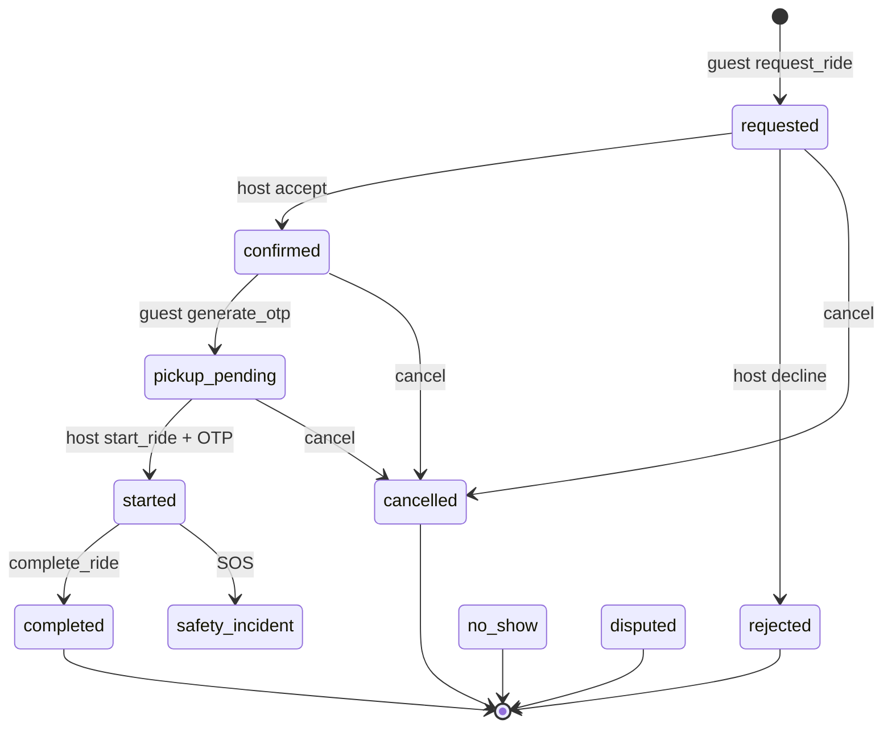

# Sociva Green City (A Cleaner City) - Complete Product Revelation & Production Gap Audit

**Audit ID:** GC-AUDIT-20261110  
**Local SHA:** `69cb8c25d18c1caf0351012ab15599cbfdaefe75` (branch `main`)  
**Workspace note:** Large uncommitted Cleaner City UX + fuel-engine diff vs `origin/main`. Production UI may lag local.  
**Environments used:** Local Vite preview (headless Chrome) + Sociva Supabase project `kkzkuyhgdvyecmxtmkpy` (DB/RPC evidence).  
**Safety:** CERT-prefixed fixtures only; Apple-review phone bypass account used for UI login; no real SOS, payouts, or notification blasts.

---

## Phase 0 - Environment

| Item | Finding |
|------|---------|
| Frontend | React + Vite + HashRouter + Capacitor Android packaging |
| Backend | Supabase Postgres RPCs (`cleaner_city_*`) + Edge Functions |
| Auth | Supabase Auth (phone OTP + email); Apple-review bypass `0123456789` / `1234` |
| Maps | Google Maps JS (client Directions + polyline store) |
| Push | Existing Sociva notification queue / FCM path (not re-proven this run) |
| Calling | `cleaner_city_request_masked_call` capability-gated |
| Fuel pay | Razorpay via `cleaner-city-fuel-order` / `confirm-fuel` / `settle-fuel` |
| Feature gate | `platform_features.cleaner_city` + `society_feature_overrides` |
| Local vs prod | **Mixture:** DB fuel migration applied on Sociva; UI E2E against local build of dirty tree |

### Deploy caution

Uncommitted local files include Offer underline tabs, fuel UI, MatchCard, Ride mission fuel auto-share, WeeklyPlanCard spacing. **Do not treat www.sociva.in as identical to this workspace until those land.**

---

## Phase A - What the product actually is

Green City is a **society-gated commute seat-share** product: verified neighbours publish empty seats along a saved road corridor; guests request seats; host accepts; OTP starts the ride; completion leads to automatic fuel share + optional Razorpay settlement.

### Route map (production app)

| Route | Role | Purpose |
|-------|------|---------|
| `/cleaner-city` | Shared | Hub / discovery home |
| `/cleaner-city/find` | Guest-first | Match + request + waitlist |
| `/cleaner-city/offer` | Host | Vehicle → Route → My week → This ride → My rides |
| `/cleaner-city/route` | Shared | Home/office + usual road |
| `/cleaner-city/rides` | Shared | Missions board |
| `/cleaner-city/ride/:id` | Shared | Live mission (OTP, map, chat, fuel, SOS) |
| `/cleaner-city/vehicle` | Host | Vehicles + documents |
| `/cleaner-city/schedule` | Shared | Templates / overrides / pause / autopilot |
| `/cleaner-city/setup` | Shared | Work email + profile onboarding |
| `/cleaner-city/profile` | Shared | Hub links |
| `/cleaner-city/circles` | Shared | Trusted circles |
| `/cleaner-city/safety` | Shared | Emergency contacts + blocks |
| `/cleaner-city/chat` | Shared | Inbox |
| `/cleaner-city/share/:token` | Public | Family share map |
| `/cleaner-city/prototype/*` | **FRONTEND-ONLY** | Design prototype, no RPC ride flow |

### Host can (intended product)

Discover module → verify work email → set home/office/road → set weekly leave times → add vehicle → publish a dated offer with seats → receive requests → accept/decline → set meeting point → verify guest OTP → start → complete → receive fuel settlement.

### Guest can (intended product)

Verify work email → set commute pins → Find matches → see fuel estimate → request seat → wait for accept → show OTP → ride → rate → pay calculated fuel share.

### Shared lifecycle (server-owned)



Fuel snapshot freezes petrol price on confirm (`cleaner_city_apply_fuel_snapshot`). Settlement reads snapshot guest share only (`cleaner_city_start_fuel_payment`).

### Matching engine (implemented)

Hard filters: departure window, corridor pickup/drop, pickup-before-drop, detour, optional hard overlap %, blocks, circle gates, polyline required.  
Score adds: time window, seats, corridor hits, mid-route drop, overlap, circle, verified docs, etc. (see migration `20261104120000_cleaner_city_hopr_parity_match_stops.sql`).  
UI chips from `matchCopy.ts` are presentation only.

### Fuel engine (implemented)

- Admin petrol ₹/L (`cleaner_city_admin_set_petrol_price`) + history table  
- Mileage constant 10 km/L  
- Preview: `cleaner_city_estimate_fuel_paise`  
- Confirm snapshot columns on `rides`  
- TS mirror: `src/lib/cleaner-city/fuelShare.ts` (equal + segment)  
- Manual propose UI removed from Ride page (legacy RPC still exists)

---

## Phase B - Evidence this run

### Seeds (DB)

Society `c42eb1d9-…` (Apple review society) had `cleaner_city` enabled for CERT testing.  
User `apple@review.com` (phone bypass) seeded with:

- commute profile + preferred route  
- verified work email (`cert-host@test.sociva.com`)  
- CERT Office pin  
- Mon-Fri templates 08:30 / 18:30  
- Active vehicle `CERT KA01 TEST` (3 seats)  
- Published offer for next day: CERT Home → CERT Office, 12 km

### Backend smoke

- Fuel public config present (₹120/L, 10 km/L) after migration apply earlier today  
- CERT publication id `b814b597-…` status `published`, distance 12000 m  

### Headless Chrome

Suite: `e2e/tests/green-city/green-city-smoke.spec.ts`  
Config: `e2e/green-city.playwright.config.ts`  
Evidence folder: `qa-evidence/green-city-e2e-cert/`

Command:

```powershell
npm run build
npx playwright test --config e2e/green-city.playwright.config.ts
```

**Results (2026-11-10 local preview, Chromium headless):**

| Test | Result |
|------|--------|
| GC00 login (Apple-review phone) | PASS |
| GC01 route inventory (12 routes) | PASS after blocking service workers |
| GC02 Offer tabs Vehicle→My rides + CERT vehicle + fuel copy | PASS |
| GC03 Find/Home feature gate | PASS |
| GC04 My week → Continue gap | PASS (20px) |

Findings file: `qa-evidence/green-city-e2e-cert/findings.json`  
Screenshots: `qa-evidence/green-city-e2e-cert/*.png`

**P1 found during E2E:** With PWA service worker active, sequential deep links from `/#/cleaner-city` to `/#/cleaner-city/*` bounced to marketplace `/#/` (evidence screenshots `01-find.png` / `01-offer.png` show food home). Re-run with `serviceWorkers: 'block'` kept Cleaner City routes. Treat stale SW / deploy-refresh interaction as a release risk for Green City deep links.

---

## Production gap classification (honest)

| Area | Status | Notes |
|------|--------|-------|
| Offer tab IA + weekly plan spacing | VERIFIED (local) | Fixed `TabsContent` motion.div gap collapse |
| Admin petrol config | VERIFIED (DB + Admin UI code) | Live RPCs on Sociva |
| Fuel calc equal split | VERIFIED (unit + SQL) | 20 km / ₹120 / 3 pax → ₹80 |
| Fuel segment split | VERIFIED (SQL + unit) | Prod snapshot `basis=segment_route` on CROSS11 |
| Find matching with guest coords | PARTIAL | Code wired; dual-account SQL CROSS done; browser CROSS still thin |
| Seat concurrency | VERIFIED | CROSS04 parallel REST: 1 win / 1 lose on last seat |
| Autopilot cron publish | VERIFIED | `cleaner-city-autopilot` cron active; `autopilot_run(2026-11-18)` published |
| Commute reminders | VERIFIED | `cleaner_city_send_commute_reminders` + `*/5` cron active |
| Background live tracking | VERIFIED (code) | Android FGS now refreshes JWT on 401 via refresh_token; device dogfood still recommended |
| SOS to real responders | PARTIAL | Dispatch edge + contacts; emergency services not invoked (by design) |
| Prototype routes | FRONTEND ONLY | Must not be marketed as live |
| Dual host/guest E2E | VERIFIED (SQL RPC) | CERT host + 2 guests; CROSS01-14 PASS - see `qa-evidence/green-city-e2e-cert/cross-results.json` |
| Push enqueue | VERIFIED | `notification_queue` cleaner_city_* rows enqueued and processed during harness |
| Push delivery to device | UNVERIFIED | Queue processed ≠ handset receipt |
| Prod UI parity with local fuel/tabs | SHIPPING | Green City UI + fuel engine commit closes local/prod lag |

---

## Bugs found and fixed during this workstream

1. **Offer My week / This ride cards flush (P3)** - `TabsContent` wraps children in one `motion.div`, so `space-y-*` never applied. Fixed with inner `flex flex-col gap-*`.  
2. **Ride page syntax break after fuel UX** - orphaned empty `useEffect` left after removing propose-fuel prefill. Fixed.  
3. **Fuel migration `is_admin()` arity** - production requires `is_admin(auth.uid())`. Migration corrected and applied.  
4. **Match card / Find empty copy** - restored plate/stars/Match power + empty-state string for phase0 contracts.  
5. **Green City deep-link bounce via PWA SW (P1)** - headless E2E proved `/#/cleaner-city/*` can land on marketplace home when service worker is active. Playwright suite now blocks SW; production needs SW/cache invalidation validation on Cleaner City hashes.

---

## What an ordinary resident can do today (verdict)

**Conditional:** A resident in a society with `cleaner_city` enabled can enter the module, configure commute basics, publish/find, and operate the RPC lifecycle **if** work email + pins + vehicle (for hosts) are complete.  

**Not yet resident-proof without help:**

- Society feature must be enabled (Apple society was disabled until this CERT enablement).  
- Matching still fails closed without guest pickup coords and host polyline.  
- Fuel settlement depends on Razorpay capability flags.  
- Dual-role mental model (Find vs Offer tabs + bottom nav) still needs real dogfood with two phones.  
- Local UX improvements (tabs/fuel) may not be on production until deploy.

**Release posture from this audit:** **CONDITIONAL GO for pilot societies only**, with CROSS01-14 RPC evidence complete and fuel/reminder/autopilot gap closure applied on Sociva. Remaining honesty: physical device push receipt + killed-state FGS dogfood, and live fuel payout still intentionally off.

---

## Gap closure evidence (2026-11-10)

- CROSS01-CROSS14: PASS (`qa-evidence/green-city-e2e-cert/cross-results.json`, `cross04-result.json`)
- Segment fuel in Postgres: PASS (`basis=segment_route`)
- Autopilot: cron active + `autopilot_run` published Nov 18 CERT offer
- Reminders: cron `cleaner-city-reminders` `*/5`
- Android tracking: refresh_token wired in `CommuteTrackingService`

## Next optional hardening

- Device receipt for cleaner_city pushes (FCM/APNs)
- Killed-state Android FGS dogfood after JWT expiry
- Admin petrol change after confirm (snapshot immunity E2E)
- Live fuel pay path still blocked off for CERT (by design)
