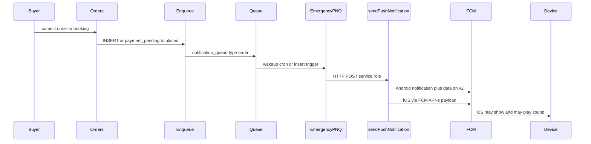

# Sociva seller notification reliability audit

Date: 2026-10-24
Status: audit complete; remediations in the same change set
Production project: kkzkuyhgdvyecmxtmkpy
Evidence rule: FCM or APNs HTTP 200 is provider acceptance, not device display or audible bell.

This document is the 2026-10-24 production reliability audit. It supersedes docs/audits/SOCIVA-ORDER-NOTIFICATION-RELIABILITY-AUDIT.md (2026-10-10) on sound assets, preparing priority, retry backoff, the INSERT trigger, the emergency queue worker, and the Android version gate.

# Seller Notification Reliability Audit

**Date:** 2026-10-24
**Scope:** production project `kkzkuyhgdvyecmxtmkpy` (Sociva), current repository, deployed Edge Functions
**Method:** source + live schema/triggers/cron + queue rows + function logs. No device tests. No code or config changes.
**Prior audit:** [docs/audits/SOCIVA-ORDER-NOTIFICATION-RELIABILITY-AUDIT.md](docs/audits/SOCIVA-ORDER-NOTIFICATION-RELIABILITY-AUDIT.md) (2026-10-10) is **stale** on sound assets, `preparing` priority, retry backoff, and enqueue INSERT trigger. It did not see the later emergency worker or the zero-stamp Android gate.

**Evidence rule:** FCM/APNs HTTP 200 is provider acceptance, not device display or audible bell.

---

## A. Executive Summary

Seller notifications are **partially reliable at the backend/provider layer and unverified at the ear.**

**What is confirmed working**
- Instant and scheduled product orders enqueue a seller `notification_queue` row and wake a worker.
- Production logs for a 2026-10-23 08:02 IST-day instant order requested `gate_bell` / `gate_bell.caf`, `isHighPriority=true`, `timeSensitive=true`, and FCM returned acceptance for **both** an Android token and an iOS token.
- A scheduled order titled `Scheduled order for 23 Oct, 12:00 PM` was enqueued at placement (Event A) and later received `seller_scheduled_prep` (Event B).
- Book-a-Table is implemented as **service booking** (no separate restaurant-table product). Creation **does** enqueue `New Booking Confirmed` for the seller.

**Most serious confirmed defects**
1. **Deployed `process-notification-queue` is not the repo source.** Live version 96 is an emergency stub (`emergency: true`) that HTTP-calls `send-push-notification`, marks `processed` on HTTP 200 even when `sent: 0`, and has **no retry/backoff**. Repo source in [supabase/functions/process-notification-queue/index.ts](supabase/functions/process-notification-queue/index.ts) is a different, richer worker.
2. **The Android native closed-app bell is not active in production.** `seller_alert_android_config.mode = version_gated`, min 67, but **0/138** `device_tokens` rows have `alert_capability` or `app_version_code`. Every Android order alert therefore uses **legacy FCM notification+data on `orders_incoming_v2`**, not data-only `orders_incoming_v3` handled by `OrderAlertMessagingService`.
3. **`orders_incoming_v2` is never created natively.** Native code only creates `orders_incoming_v3`. v2 exists only after JS in [src/hooks/usePushNotifications.ts](src/hooks/usePushNotifications.ts) has booted. Killed-app Android sound depends on the OS displaying an FCM *notification* message on a JS-created channel. If that channel was first created without `gate_bell`, Android will not let code fix the sound.
4. **Queue telemetry cannot prove delivery.** Last 7 days of seller order/reminder rows are `processed` with `push_attempted=true` but `push_success_count=0` and `push_fail_count=0` because the emergency worker never writes those fields.
5. **Bookings notify at create, then degrade.** Creation is duplicated (`New Booking Confirmed` plus `New order: 1x …` from the item trigger). Reschedule does not notify the seller. Approaching-time seller reminders are not high-priority bell alerts.

**Verdict (facts vs assumptions)**
- **Android:** backend asks for `gate_bell` on v2. Native v3 killed-app path is **confirmed unused**. Whether the seller hears the bell is **unverified** (channel history, DND, OEM battery).
- **iOS:** backend asks for `gate_bell.caf` and time-sensitive on new `placed`/`confirmed` seller alerts. Representative order used **FCM, not direct APNs**. Sound on Silent/Focus cannot be guaranteed.
- **Scheduled orders:** Event A (immediate) **confirmed**. Event B (prep/due) **implemented and sometimes fires**, but hourly cron vs 10-20 minute windows can miss.
- **Instant orders:** enqueue + high-priority payload + FCM accept **confirmed**.
- **Book-a-Table:** seller is informed at creation **confirmed in queue**. Reliable unique bell + later events **not confirmed**.

---

## B. Current Notification Architecture

**Product orders**
1. Checkout: `create_multi_vendor_orders` (COD/`placed` immediately; prepaid starts `payment_pending`).
2. Closed store: buyer must pick a slot (`schedule_required`). Vacation/paused stores are rejected. Opening-hours checks are **creation-time only**.
3. Enqueue: live `enqueue_seller_new_order_notification` (migration [supabase/migrations/20261021220000_closed_store_scheduled_ordering.sql](supabase/migrations/20261021220000_closed_store_scheduled_ordering.sql)). Title is `New order: …` or `Scheduled order for {date}, {time}`. Payload `target_role=seller`, `type=order`. **No `high_priority` field** (worker infers from status).
4. Triggers (live, enabled):
   - `trg_enqueue_new_order_on_insert` for status in `placed, preparing, enquired, requested, quoted`
   - `trg_enqueue_new_order_notification` on `payment_pending` -> `placed|preparing`
   - `trg_enqueue_new_order_on_item` on `order_items` INSERT if status is not `payment_pending`/`cancelled`
5. Wake: `trg_process_notification_queue` + Vault secret `pnq_worker_secret` (present) + cron `wakeup_notification_queue_if_pending` every minute (active).
6. **Live worker:** emergency PNQ v96 -> `send-push-notification` v66 (has v2/v3 gate, `gate_bell.caf`, time-sensitive).
7. Android: **always v2 notification+data today**. iOS: FCM with `aps.sound=gate_bell.caf` (direct APNs not observed on the sampled order).

**Service bookings (Book-a-Table)**
- Tables: `orders` (`order_type=booking`, `transaction_type=service_booking`) + `service_bookings`.
- Create RPC `create_service_booking_atomic` inserts status `confirmed` and a queue row `New Booking Confirmed` with `high_priority:true`.
- Insert trigger does **not** fire (`confirmed` not in its list), but **item trigger does**, causing a second seller row.
- Status updates: `trg_enqueue_order_status_notification` via `category_status_flows`.
- Approaching reminders: `send-booking-reminders` every 5 minutes (buyer + seller, **not** high-priority bell).

**In-app path (not closed-app)**
- [src/hooks/useNewOrderAlert.ts](src/hooks/useNewOrderAlert.ts) Web Audio loop while the seller UI is mounted.
- [src/lib/local-order-notifications.ts](src/lib/local-order-notifications.ts) Capacitor local notification on v3.
- These **stop when the process is gone**.

---

## C. Notification Behavior Matrix

Status key: **Dispatch confirmed** = queue + (where logged) provider accept. **Bell unverified** = no device recording. **Broken** = source/production contradiction that will drop or duplicate notify.

| Scenario | Android | iOS | Backend event | Type / payload | Visible push requested | Bell configured | Bell expected | Status |
|---|---|---|---|---|---|---|---|---|
| Instant during hours | FCM v2 notification+data, `gate_bell` | FCM APNs payload `gate_bell.caf`, time-sensitive | INSERT `placed` (COD) or payment confirm | `order`, status `placed`, role seller | Yes | Yes | Yes if permission/channel/volume allow | Dispatch confirmed 2026-10-23 08:02; device bell unverified |
| Instant outside hours | N/A if rejected | N/A | `schedule_required` or `STORE_CLOSED` | None | No | No | No | By design: not an instant order |
| Scheduled created while open | Same as instant, title `Scheduled order for …` | Same | INSERT `placed` with `scheduled_date` | `order` | Yes | Yes | Yes | Dispatch confirmed (22-23 Oct rows) |
| Scheduled created while closed | Same, not suppressed by hours | Same | Same enqueue; hours only validate the slot | `order` | Yes immediately | Yes | Yes immediately | **Confirmed: no closed-store suppress in notify path** |
| Preorder future date | Same Event A | Same | `accepting_preorders` bypass | `order` | Yes at placement | Yes | Yes | Source-confirmed; few live rows |
| Fulfilment time arrives | `seller_scheduled_prep` / `_30m` / `_late` | Prep/late are HP but **not** time-sensitive | Hourly cron `send_scheduled_order_reminders_hourly` | `seller_scheduled_prep` etc | Yes if window hits | Prep/late yes | Second bell possible | Implemented; **can miss** due to hourly cron vs 10-20 min windows |
| Book-a-Table create | Two HP seller pushes possible | Two HP pushes possible | RPC insert + item trigger | `order` `confirmed` and `New order: 1x …` | Yes | Yes | Yes, possibly twice | Queue confirmed 2026-10-10 Beard Trim |
| Booking needs seller approval | N/A | N/A | `requested` flow is `is_deprecated` | None | No | No | No | Auto-confirm only |
| Booking auto-confirm | Same as create | Same | `confirmed` | `New Booking Confirmed` | Yes | Yes | Yes | Confirmed |
| Accept/reject | No accept step | No accept step | N/A | N/A | N/A | N/A | N/A | Not in product |
| Cancel | Ordinary (not HP) | Ordinary | Flow `cancelled` + client `enqueue_user_notification` | Duplicate titles | Yes | Default sound | No priority bell | Duplicate seller rows confirmed |
| Reschedule | **No seller push** | **No seller push** | `rescheduled` `notify_seller=false` | Buyer only | Seller no | No | No | **Confirmed gap** |
| Multi-vendor | One order + one queue row per seller | Same | Loop in `create_multi_vendor_orders` | Per seller | Yes | Yes | Yes | Source-confirmed |
| App foreground | Native post skipped if screen on; JS bell + local notif | Capacitor `presentationOptions` include sound | Same | Same | Yes | Yes | Yes, can double | Source-confirmed overlap risk |
| App background | OS shows FCM notification on v2 | OS shows APNs/FCM alert | Same | Same | Yes | v2 channel | If v2 exists and unmuted | Unverified on device |
| App terminated | Native service **not** used (unstamped). OS FCM auto-display on v2 | OS alert, no JS | Same | Same | Yes | v2 / caf | If OS presents | Native v3 path confirmed unused |
| Phone locked | Native would post if data-only; live path is FCM notification | Lock screen alert | Same | Same | Yes | Channel/caf | If not silenced | Unverified |
| Android DND | `IMPORTANCE_HIGH` does **not** bypass DND (`setBypassDnd` absent) | N/A | Same | Same | May be silent | Configured | Not guaranteed | Confirmed limitation |
| iOS Silent/Focus | N/A | Mute switch always wins. Time-sensitive only if Focus allows Time Sensitive | Same | `interruption-level` only for placed/enquired/requested/confirmed seller events | Banner maybe | caf requested | Not guaranteed | Confirmed platform limit |
| Missing/expired token | SPN returns HTTP 200 `sent:0`; emergency PNQ marks **processed** | Same | Same | Same | No | N/A | No | **Confirmed: no retry** |
| Logout / token refresh | `claim_device_token` + `stampClientBuild` | APNs + FCM tokens saved | Client [usePushNotifications.ts](src/hooks/usePushNotifications.ts) | N/A | Depends | N/A | N/A | Stamp **never succeeding** in prod |

---

## D. Bell Sound Root-Cause Analysis

**Priority layers (they are not the same)**
- **FCM `android.priority=high`:** wakes the device / timely delivery attempt. Does not choose the sound.
- **Android channel importance:** `IMPORTANCE_HIGH` on v3 (native) and v2 (JS). Controls heads-up and whether the *channel* may sound. User and OEM can lower it. First create freezes sound.
- **Notification sound:** Android 8+ uses the **channel** sound, not `NotificationCompat.setSound`. iOS uses `aps.sound` filename in the app bundle.
- **Time-sensitive / full-screen:** iOS `interruption-level: time-sensitive` plus entitlement in Codemagic-generated `App.entitlements`. Android has **no** full-screen intent and **no** DND bypass.

**When the Android bell can ring**
1. **Foreground, screen on:** JS `useNewOrderAlert` and/or local notification on v3. Native `postOrderAlert` is skipped ([OrderAlertMessagingService.java](android/app/src/main/java/app/sociva/community/OrderAlertMessagingService.java) lines 29-34).
2. **Background/killed, current production:** FCM **notification** message on channel `orders_incoming_v2`. OS plays that channel's sound if the channel exists, is unmuted, permission is granted, and DND/OEM allow it. `OrderAlertMessagingService` is typically **not** invoked for notification+data while backgrounded.
3. **Designed killed-app path (not live):** data-only FCM on `orders_incoming_v3` -> `OrderAlertMessagingService.postOrderAlert`. Requires stamped token (`order_alert_native_v1` and `app_version_code >= 67`). **Production count of such tokens: 0.**

**When it does not ring**
- Notification permission denied (Android 13+ `POST_NOTIFICATIONS`).
- v2 never created (app never fully booted JS) or created before `gate_bell` existed (immutable silent channel).
- DND / OEM battery restrictions (no mitigation in app).
- Token missing: emergency worker still marks processed.
- Non-HP types (`cancelled`, most booking reminders, `seller_approved` in live SPN) request `default` sound. Production log 2026-10-24 08:17: `seller_approved` -> `ios_sound: default`.

**When it rings twice**
- Foreground: Capacitor auto-display of FCM notification (v2) plus JS local notification (v3) plus Web Audio loop.
- Bookings: two queue rows at create.
- Unacked reminders every ~10 minutes while status stays `placed` (`send-seller-status-reminders` cron every 5 minutes; 3 reminders observed 03:20-03:40 on 23 Oct).

**iOS**
- Sound file `ios-config/gate_bell.caf` is CI-copied into the bundle. Format/duration vs Apple's 30s custom-sound limit: **unverified** (file is ~3.5 MB).
- Time Sensitive entitlement is generated in [codemagic.yaml](codemagic.yaml) and IPA-validated.
- Silent switch and restrictive Focus **cannot** be overridden.
- Sampled seller order used FCM for iOS, not `sendApnsDirectNotification`. Custom sound still requested inside the FCM `apns.payload`. Direct APNs health is **unverified**.

---

## E. Scheduled Order Findings

**Q1. Can a buyer place a scheduled order while the store is closed?** Yes, if they pick a valid future slot. Instant checkout without a slot returns `schedule_required`. Vacation/paused stores are blocked.

**Q2-4. Persist and notify immediately?** Order row is committed in `create_multi_vendor_orders`. Seller push is **not** suppressed because the store is closed now. Event A fires at commit (or after prepaid capture). Production: `Scheduled order for 23 Oct, 12:00 PM` at 2026-10-23 03:16 UTC, then `push_priority` high + time-sensitive + `gate_bell`.

**Q5. Wrong clock comparison at notify time?** No. Notify path does not read store hours. Slot validation uses `seller_scheduled_slot_is_valid` at **create** time.

**Q6. Bell immediately, at actionable time, or both?** **Both are intended.** Event A at placement. Event B via [supabase/functions/send-scheduled-order-reminders/index.ts](supabase/functions/send-scheduled-order-reminders/index.ts): 48h, 24h, prep unlock, 30m, late. Prep/late set `high_priority`. 48h/24h/30m are not time-sensitive.

**Q7. Accept now or later?** Copy says "Tap to review and accept." Auto-cancel SLA still applies (`_auto_cancel_at = now()+30min` for scheduled creates). Seller is expected to act on Event A, not only at prep time. Unacked reminders fire if they do not.

**Q8-9. Later worker and timezone?** Hourly cron at minute 15, active. Function uses `istNow()` via `toLocaleString` (fragile) then UTC `Date` for window math. Prep window is 20 minutes after `preparation_start_at`; 30m window is 10 minutes wide. **Hourly cron can miss those windows.** Production did hit prep at 06:15 on 23 Oct, so it is not always dead.

**Q10. Unnoticed until app open?** Possible if token missing (processed with sent 0), v2 silent, OEM kill, or Event B missed. Not the designed path.

**Q11. Competing paths?** Event A: DB triggers. Event B: cron edge function. Unacked: `send-seller-status-reminders`. Plus JS in-app bell if open.

**Q12. Late notify after cancel?** PNQ source has stale/terminal guards; **emergency worker does not**. A delayed retry is less relevant because emergency does not retry, but a late Event B cron could still enqueue after cancel if status filter fails (late window excludes some statuses; 48h/24h/prep do not exclude `cancelled` in the query's `in` list, and cancelled is not in that list so cancelled orders are skipped). Mostly safe.

**Event A vs Event B:** current implementation supports **both**, with Event B **best-effort** due to cron/window mismatch.

---

## F. Instant Order Findings

- Trigger: `trg_enqueue_new_order_on_insert` when status is `placed` (COD) or status update from `payment_pending` after [supabase/functions/confirm-razorpay-payment/index.ts](supabase/functions/confirm-razorpay-payment/index.ts).
- Prepaid: **no seller notify until payment is captured.** COD: immediate.
- Multi-vendor: one notification per seller order row.
- Bell: same HP path as scheduled Event A (`placed` is in `SELLER_HP` in both emergency PNQ and SPN).
- Production evidence (redacted): 2026-10-23 08:02:10 `isHighPriority=true`, `timeSensitive=true`, `android_sound=gate_bell`, `ios_sound=gate_bell.caf`; `[Push] android device - using FCM`; `[Push] ios device - using FCM`; two `[FCM] Delivered` lines.
- Difference vs scheduled: title/body and later Event B cron. Same enqueue function. Same HP detection.

---

## G. Book-a-Table Findings

**There is no separate Book-a-Table module.** The product is **service booking**.

**Does it inform sellers today?** **Yes, at creation**, with evidence:
- Live RPC stamps `high_priority:true`, `target_role:seller`.
- Production booking 2026-10-10 had queue titles `New Booking Confirmed` and `New order: 1x Beard Trim`.
- `confirmed` is in SPN/PNQ HP lists and in `OrderAlertMessagingService` and `isIosTimeSensitiveSellerAlert`.

**Confirmed failures / gaps (not merely missing templates)**
- **Duplicate create notify:** `fn_enqueue_new_order_on_item` runs for any non-pending order, including `confirmed` bookings. Item trigger is live (`tgenabled=O`).
- **Reschedule:** all live `category_status_flows` `rescheduled` rows have `notify_seller=false`. Client [BuyerRescheduleBooking.tsx](src/components/booking/BuyerRescheduleBooking.tsx) has no seller fallback.
- **Cancel duplicate:** client enqueue plus flow trigger.
- **Approaching appointment:** `send-booking-reminders` notifies seller with type `booking_reminder_*`, dest `/seller/orders`, **no high_priority**. Default sound. Dedup is a jsonb `contains` on `bookingId` (fragile; 30-min window had an extra row).
- **No-show:** duplicate `category_status_flows` rows with conflicting `notify_seller`; `fn_enqueue_order_status_notification` uses `LIMIT 1` without `ORDER BY`.
- Push dest is `/orders/{id}`, not BookingsHub. Seller can open the order if they tap.

Device-level booking bell: **unverified**. Queue + HP mapping are confirmed; ear is not.

---

## H. Confirmed Defects

1. **Critical - Both platforms - all seller alerts - deployed worker != source.** Live PNQ v96 is [tmp-pnq-emergency.ts](tmp-pnq-emergency.ts) behavior. No exponential retry, no no-token block, HTTP 200 with `sent:0` is success. Impact: lost orders look "processed".

2. **Critical - Android - all order/booking HP alerts - native v3 path never selected.** Gate `version_gated`/67 live; `stamp_device_token_client_build` exists; **0 tokens stamped**. SPN therefore always uses `LEGACY_ANDROID_ORDER_CHANNEL`. Impact: closed-app reliability depends on FCM notification + v2 channel, which the native service was written to replace.

3. **High - Android - v2/v3 mismatch.** Native [OrderAlertChannels.java](android/app/src/main/java/app/sociva/community/OrderAlertChannels.java) creates only v3. Backend live path sends v2. JS creates v2 only after WebView boot. Channel sound immutable. Impact: silent or default sound on some installs; cannot be fixed by shipping a new MP3 on the same id.

4. **High - Both - missing token treated as done.** SPN returns 200 `No device tokens found`. Emergency PNQ marks processed. Repo source would `blocked` and retry 30 minutes. Impact: sellers who never granted push, or whose tokens were deleted, never get a later bell.

5. **High - Both - one token per platform.** Live SPN dedupes by platform, not by token. Second phone on the same OS is dropped. Repo PNQ source would send up to 8 tokens.

6. **High - Scheduled Event B - hourly cron vs short windows.** `scheduled_prep` 20 min, `scheduled_30m` 10 min, cron `15 * * * *`. Impact: seller may get Event A only and miss prep unlock.

7. **High - Bookings - duplicate create + no reschedule seller notify.** Item trigger + RPC; `notify_seller=false` on reschedule. Impact: double bell or missed change.

8. **Medium - Android DND / OEM.** No `setBypassDnd`, no battery-optimization UX. Impact: "no bell" reports on Xiaomi/Oppo/Vivo/DND that look like app bugs.

9. **Medium - iOS Time Sensitive narrower than HP.** `quoted`/`preparing`/prep reminders ring default-vs-caf via HP but are not time-sensitive. Impact: Focus may hide prep reminders.

10. **Medium - Buyer scheduled_prep requested `gate_bell`.** Log 2026-10-23 06:15:04 `target_role=buyer`, `isHighPriority=true`, `android_sound=gate_bell`. Emergency HP includes `reminder_type === scheduled_prep` with no role check.

11. **Low - Dead iOS NSE.** [native/ios/NotificationServiceExtension.swift](native/ios/NotificationServiceExtension.swift) is not in Codemagic. `mutable-content` is a no-op.

12. **Low - Foreground double sound.** Capacitor `presentationOptions` includes `alert` plus JS local notification.

---

## I. Unverified Risks

- Physical bell on locked/terminated Android and iOS (needs instrumented test devices).
- Whether production APK/IPA actually contains `gate_bell` (source and CI copy do; store binary not unpacked in this run).
- Why `stamp_device_token_client_build` never writes: Play build older than 2026-10-10 JS, RPC UPDATE token mismatch, or stamp errors swallowed in `pushLog`. Evidence needed: Play `versionCode`, `push_logs` `CLIENT_BUILD_STAMP_FAILED`, and one seller session.
- Direct APNs vs FCM-for-iOS globally (sampled order used FCM for iOS). Check `apns_key_p8` via `get_edge_credential` meta only, and logs for `using direct APNs`.
- CAF duration > 30s (Apple would then skip custom sound).
- Historical v2 channels created without sound on seller devices (Android settings screenshot).
- `pnq_worker_secret` length >= 32 (name exists; value not read).
- Whether `SELLER_ALERT_ANDROID_MODE=legacy` env overrides DB (DB is version_gated; env unknown).

---

## J. Recommended Remediation Plan (do not implement in this phase)

**Minimum safe plan (must not break existing v2 sellers)**
1. **Keep sending `orders_incoming_v2` notification+data** until a measured share of Android seller tokens is stamped. Do not flip the world to data-only.
2. **Replace emergency PNQ with the repo worker, or patch the stub** so `sent:0` is `blocked`/`failed` with retry, and persist `push_success_count` / provider ids. Deploy as a function-only change. Do not change Android channel ids in the same release.
3. **Fix stamp:** log no-op UPDATEs, stamp after claim with the exact stored token, backfill from app `versionCode` 67+ on next open. Only then enable data-only per token.
4. **Keep creating v2 in JS** for the rest of the fleet. Add in-app copy to open **channel settings** if the seller reports no sound (cannot mutate v2).
5. **Booking:** skip `enqueue_seller_new_order_notification` when `order_type=booking` (item trigger), keep the RPC `New Booking Confirmed`. Do not drop the RPC.
6. **Event B:** run scheduled-order reminders every 5 minutes (job already exists for booking reminders) **or** widen prep/30m windows. Do not remove Event A.
7. **Do not delete v2/v1/orders_alert channels.** Do not change v3 id.

**Then (after stamps and worker restore)**
- Android: data-only v3 for verified tokens only.
- Optional new channel `orders_incoming_v4` only if v3 was created without sound (not indicated in source).
- iOS: confirm direct APNs; keep FCM fallback.
- Reschedule seller notify as a **new** product decision, not a silent change.

**What belongs where**
- Backend: PNQ restore, token stamp, booking item-trigger guard, reminder cron, no-token retry, stop treating sent 0 as processed.
- Android: stamp must actually run; optional DND/OEM guidance; do not rely on `Builder.setSound`.
- iOS: keep caf + time-sensitive entitlement; document Silent/Focus; wire NSE only if rich images matter.

---

## K. Regression Test Plan (executable, not yet run)

Do **not** place real customer orders. Use a designated test seller/buyer.

For each case record: OS version, app `versionCode`/`CFBundleVersion`, store hours, order type, payment method, queue id, SPN `push_priority` log, FCM/APNs response (no raw tokens), shade vs sound, channel id shown in Android settings.

**Cases**
1. Android, app killed, screen off, instant COD, store open. Expect: tray notification, `gate_bell` on v2 (current prod) or v3 if stamped. Fail if only in-app after open.
2. Same, store closed, scheduled slot. Expect Event A immediately with title `Scheduled order for …`. Fail if silent until next open.
3. Wait until `preparation_start_at`. Expect Event B `Start preparing now` or document cron miss.
4. iOS killed + locked, Silent off, Focus off. Expect banner + caf. Repeat Silent on (expect no sound). Repeat Focus without Time Sensitive (expect suppressed sound).
5. Android DND with and without "override DND" for the channel.
6. Permission denied: no tray; queue should **not** sit in processed-success forever after PNQ fix.
7. Booking create: exactly one seller HP push, dest `/orders/{id}`. Reschedule: seller push (after product fix) or documented none (today).
8. Multi-vendor: each seller one push.
9. Two Android devices same seller: both ring (after SPN dedupe fix); today only newest platform token.
10. Foreground: at most one OS sound plus optional in-app loop.

Pass = provider log + device display + (for HP) audible bell when OS settings allow. Provider 200 alone is fail for "bell" cases.

---

## L. Final Answers to Business Questions

1. **When does an Android seller hear the priority bell?** Today: when FCM delivers a **notification** message to `orders_incoming_v2`, that channel is allowed to sound, and the OS is not in DND/OEM-sleep. Foreground: JS/local notification. The native killed-app v3 service is **not** in the live path.
2. **When does an iOS seller hear it?** When an alert arrives with `aps.sound=gate_bell.caf`, authorization includes sound, Silent is off, and Focus allows the alert (Time Sensitive helps only for placed/enquired/requested/confirmed seller events). JS is not required when the app is dead.
3. **Scheduled order outside hours: immediate notify?** **Yes.** Event A at successful placement. Not suppressed by current store hours.
4. **Notify again at fulfilment?** **Intended yes** (prep/30m/late). **Sometimes yes** in production. **Can miss** because of hourly cron vs short windows.
5. **Instant order priority bell?** **Requested and FCM-accepted, yes.** Ear unverified.
6. **Book-a-Table notify sellers reliably?** **Creation: yes, with a duplicate risk. Reschedule: no. Approaching: seller gets a normal reminder, not the priority bell.**
7. **Confirmed broken paths?** Emergency PNQ success-on-empty-send; Android native v3 unused; stamp never writes; v2/v3 split; booking duplicate create; booking reschedule seller silence; Event B window miss; one-token-per-platform; buyer prep using gate_bell.
8. **Fix location?** Backend first (worker, stamp, booking trigger, cron). Android channel migration only if v2 is proven silent, and only via a **new** id. iOS mainly verify APNs + document Silent/Focus.
9. **Minimum safe remediation?** Restore/patch PNQ without changing channel ids; keep v2 payloads; make stamp work; then per-token v3; booking item-trigger guard; 5-minute scheduled reminder cron. Never delete legacy channels.

---

## M. Remediations applied (2026-10-24)

Production project `kkzkuyhgdvyecmxtmkpy`. Channel ids `orders_incoming_v1` / `v2` / `v3` / `orders_alert` were not changed. Android stays on v2 notification+data until a token is stamped.

| Item | Live evidence |
| --- | --- |
| Queue worker | `process-notification-queue` v97, `verify_jwt=false`, `emergency: false`. Parses SPN `sent`. Seller `sent:0` is `blocked` with 5-minute retry, then `failed` after 30 minutes. Other failures back off up to 9 attempts. Writes `push_success_count`. |
| Push sender | `send-push-notification` v67, `verify_jwt=true`. `skip_reason=no_tokens`. Dedupes by token string, cap 8. Buyer cannot inherit seller `gate_bell`. Unstamped Android still uses `orders_incoming_v2`. |
| Stamp RPC | `stamp_device_token_client_build` returns jsonb `{updated}`. Native capability stamps matching token or all valid Android tokens for the user. Client hook retries when `updated<1`. Fleet still 0/138 stamped until that build is on devices. |
| Bookings | Item trigger skips `order_type=booking` / `transaction_type=service_booking`. `New Booking Confirmed` RPC kept. Six `rescheduled` service_booking flows have `notify_seller=true`, title `Appointment rescheduled`. |
| Event B | Cron `send_scheduled_order_reminders_every_5m` is `*/5 * * * *` and active. Hourly job removed. Wakeup cron still every minute. |

Physical killed/locked/DND bells are not claimed. See [SOCIVA-SELLER-NOTIFICATION-DEVICE-MATRIX-2026-10-24.md](SOCIVA-SELLER-NOTIFICATION-DEVICE-MATRIX-2026-10-24.md).