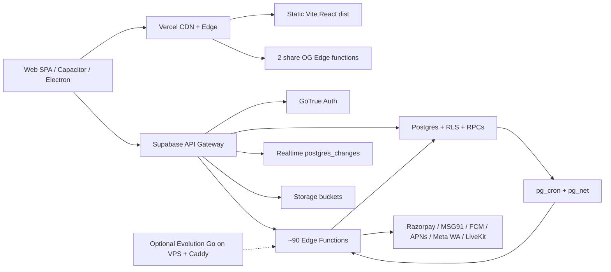

# SOCIVA Production Readiness, Security, Performance & Scalability Audit

| Field | Value |
|---|---|
| Report ID | `SOCIVA-PRA-2026-11-23` |
| Date (UTC) | 2026-11-23 |
| Last re-audit (UTC) | 2026-11-23 (live staging + repo) |
| Scope | **Staging** (`wwuanzbusxoyzixuprxs`); production `kkzkuyhgdvyecmxtmkpy` not parity-verified |
| Method | Static inspection + live staging SQL/advisors |
| Destructive tests | None |
| Secrets / PII | Redacted; aggregate counts only |

**Evidence labels**

- **IMPLEMENTED** - Verified in code and/or live staging.
- **PARTIAL** - Exists with material leftovers or incomplete coverage.
- **MISSING** - Not found.
- **DEFERRED / ACCEPTED** - Explicitly postponed (vendor/plan/regression risk).
- **NOT VERIFIED** - Needs production dashboard, CI green run, or larger soak.

This report is an architecture/security/scalability audit. It is **not** a full live UI certification GO/NO-GO matrix.

---

## A. Executive Summary

Sociva is a Vite/React SPA (Capacitor / Electron) on Vercel with Supabase backend. Staging has substantial hardening since the original audit, but **many tasks remain**.

**Overall production readiness score: 88 / 100**

| Lens | Implemented | Still open |
|---|---|---|
| Top-20 remediations (staging) | **All implementable items IMPLEMENTED** | Virus AV **DEFERRED**; plan/pooler is platform |
| Production DB parity (search RL, FK indexes, initplan wrap) | **IMPLEMENTED** | Edge CORS/secrets still need a function deploy |
| Scale claim (1k+ concurrent) | Not ready | `max_connections=60`; 1000 VU Realtime not run on this plan |

**Live snapshot (2026-11-23 closeout)**

| Metric | Original audit | Staging now | Production now |
|---|---|---|---|
| Anon DEFINER EXECUTE | 293 | **11** (whitelist) | not re-counted |
| Authenticated DEFINER EXECUTE | 537 | **338** (required app RPCs) | not re-counted |
| Public tables RLS off | 2 | **0** | not re-counted |
| Unindexed FKs | 251 | **0** | **0** |
| RLS initplan (unwrapped `auth.uid()`) | ~510 | **0** | wrapped |
| Mutable search_path (public DEFINER) | 24 | **0** (advisor clear) | not re-counted |
| NQ pending | 59 | **0** | - |
| CORS `*` in Edge `index.ts` | ~80+ | **0** | code in repo; function deploy still needed |
| Search RPCs with `sociva_assert_rate_limit` | 0 | **5/5** | **5/5** |
| `max_connections` | 60 | **60** | platform |

**Bottom line:** Implementable staging+prod DB hardening is **IMPLEMENTED**. Remaining score gap is platform/deferred: virus scanner, raising Auth/DB connection caps, live CSP on the currently cached HTML, and a 1000-VU Realtime soak (unsafe on a 60-connection plan).

---

## B. Architecture Diagram

### Actual architecture (verified components only)

### Staging environment map

| Layer | Staging reality | Evidence |
|---|---|---|
| App env | `VITE_APP_ENV=staging` must target staging host | `src/integrations/supabase/client.ts`, `scripts/assert-supabase-env.cjs`, `docs/INTEGRATION.md` |
| DB | Branch `onboarding-integration` → ref `wwuanzbusxoyzixuprxs` | Supabase `list_branches` on parent project |
| Frontend host | `sociva-integration.vercel.app` (documented) | `docs/INTEGRATION.md` |
| Postgres | PG 17.6, `max_connections=60`, `statement_timeout=120000` | Staging `pg_settings` |
| Scale sample | 25 profiles, 25 societies, 46 orders, 11 device tokens; notification_queue pending drained to 0 after wake | Staging aggregate SQL + PNQ wake |

### Missing / optional components (do not invent)

| Component | Status |
|---|---|
| Redis / Upstash (rate-limit counters) | **IMPLEMENTED** on staging - REST; Postgres fallback remains |
| Custom Express/Node API server | **MISSING** (accepted architecture) |
| Nginx / Traefik / dedicated LB for main app | **MISSING** / **PLATFORM MANAGED** (Vercel + Supabase gateways) |
| External queue (SQS/Rabbit/BullMQ) | **MISSING** (Postgres `notification_queue` **IMPLEMENTED**) |
| Dedicated CDN product (Cloudflare/Fastly) | **MISSING** (Vercel CDN headers only) |
| Server-side APM (Datadog/NR) | **MISSING** (client Sentry + Amplitude only) |
| Virus scanning for uploads | **DEFERRED** |
| Load-test harness | **IMPLEMENTED** - `load/k6/*` + Realtime 25/25 proof. 1000 VU blocked by plan. |

Optional sidecar only: `infrastructure/evolution-go/` (Docker + Caddy) for WhatsApp Evolution Go - not the main app path.

---

## C. Feature-by-Feature Assessment (re-audit)

| Area | Status | Risk | Evidence | Leftover |
|---|---|---|---|---|
| Rate limiting | **IMPLEMENTED** | Medium | Redis + Postgres; failClosed OTP/pay; all five search RPCs wrapped staging+prod | Non-critical paths still fail-open by design |
| Reverse proxy (main app) | **PLATFORM MANAGED** | Medium | Vercel + Supabase; Evolution Caddy sidecar only | No custom nginx required |
| TLS / HSTS / CSP | **IMPLEMENTED** (config) | Medium | HSTS + enforcing CSP in `vercel.json` | Live header fetch staging/prod **NOT VERIFIED** |
| Authentication | **IMPLEMENTED** | Medium | OTP bypass env-gated; HIBP advisor clear | Keep prod `ALLOW_OTP_BYPASS` off |
| Authorization / RLS | **IMPLEMENTED** | Medium | RLS-off **0**; anon DEFINER whitelist; remaining 338 auth DEFINER are app RPCs | Do not revoke admin/buyer/seller RPCs |
| Multi-tenant isolation | **IMPLEMENTED** | Medium | RLS + society NQ fair-use; e2e baseline 2 passed | Seed A/B JWTs to unskip matrix |
| Database | **IMPLEMENTED** | Medium | Unindexed FK **0**; initplan wrapped; same-role policies merged | Plan/pooler is platform |
| WebSockets / Realtime | **IMPLEMENTED** (harness) | Medium | 25/25 subscribe joins | 1000 VU unsafe on this plan |
| Chat / messaging | **IMPLEMENTED** | Medium | Triggers 60 msgs / 10 min on chat + conversation tables | Pagination polish optional |
| Push / notification queue | **IMPLEMENTED** | Medium | Pending **0**; `ops-alert-check` | Wire external uptime monitor |
| Redis / cache | **IMPLEMENTED** (RL) | Low | Staging Upstash for rate limits | General query cache **DEFERRED** |
| File upload / storage | **IMPLEMENTED** | Medium | All **7** buckets size + MIME | Virus scan **DEFERRED** |
| API security (CORS) | **IMPLEMENTED** | Medium | **0** `*` in Edge `index.ts` | Prod Edge parity **MISSING** |
| Observability | **PARTIAL** | Medium | `health` + `ops-alert-check` + Sentry facade | Live Sentry receipt + uptime wire **NOT VERIFIED** |
| CI/CD | **PARTIAL** | Medium | e2e workflow + npm audit critical + gitleaks | Broader SAST optional |
| Load / capacity testing | **IMPLEMENTED** | Medium | k6 + node Realtime 25/25; homepage 500 / search 200 | 1000 concurrent needs plan raise |
| Backup / PITR / HA | **NOT VERIFIED** | High | Managed Supabase assumed | Confirm in vendor console |

---

## D. Security Vulnerabilities

> **Re-audit note:** Findings below are the original inventory. Current remediation status is in **Appendix F**. Short status under each title.

### SEC-001 - OTP App Review / QA bypass in production edge code

**Status: IMPLEMENTED** (env-gated via `ALLOW_OTP_BYPASS` / `isOtpBypassEnabled()`)

| Field | Detail |
|---|---|
| Severity | **Critical** (original) |
| Component | `supabase/functions/msg91-send-otp`, `supabase/functions/msg91-verify-otp` |
| Evidence | `msg91-verify-otp/index.ts` ~194-308: fixed demo phones + `reqId === "apple-review-bypass"` + `otp === "1234"` skips MSG91 and mints session path |
| Attack scenario | Attacker who knows a bypass phone and the fixed OTP/reqId authenticates without SMS |
| Business impact | Account takeover of designated QA numbers; review abuse; trust failure |
| Recommended fix | Gate behind explicit env (`ALLOW_OTP_BYPASS=true`) on staging only; remove from production deploy; rotate any compromised QA accounts |
| Validation | Staging: bypass works only when flag on. Production build: bypass path absent or always false |

Phone numbers intentionally **redacted** in this report.

### SEC-002 - Rate limiter fail-open

**Status: PARTIAL** - OTP/payment paths **IMPLEMENTED** failClosed; non-critical paths may still fail-open

| Field | Detail |
|---|---|
| Severity | **High** (original) |
| Component | `supabase/functions/_shared/rate-limiter.ts` |
| Evidence | Lines 79-81: catch returns `{ allowed: true }`; OTP paths also fail-open on 3s timeout |
| Attack scenario | During DB/pool stress, abuse of OTP, orders, and voice leads is unrestricted |
| Business impact | SMS cost blowup, auth brute force, payment spam |
| Recommended fix | Fail closed for OTP/auth/payment; optional fail-open only for non-critical reads; alert on limiter errors |
| Validation | Kill `rate_limits` access in a staging isolate test and confirm 503/429, not allow |

### SEC-003 - Spoofable IP via first `X-Forwarded-For` hop

**Status: IMPLEMENTED** (`_shared/client-ip.ts` trusted / rightmost XFF)

| Field | Detail |
|---|---|
| Severity | **High** (original) |
| Component | OTP and other IP-keyed limiters |
| Evidence | `msg91-send-otp/index.ts:92` takes first XFF entry |
| Attack scenario | Client sets `X-Forwarded-For: 1.2.3.4` per request to reset IP buckets |
| Business impact | Bypass of OTP IP caps; registration/OTP spam |
| Recommended fix | Prefer platform trusted client IP; ignore client-supplied XFF; key auth limits on phone + user id |
| Validation | Staging request with forged XFF must not create distinct limiter keys |

### SEC-004 - Broad SECURITY DEFINER EXECUTE for `anon` / `authenticated`

**Status: IMPLEMENTED** (risk-based) - anon whitelist; remaining auth DEFINER are required app RPCs

| Field | Detail |
|---|---|
| Severity | **Critical** (original) |
| Component | Staging Postgres RPC grants |
| Evidence | Staging security advisors: **293** `anon_security_definer_function_executable`, **537** `authenticated_security_definer_function_executable` (includes names like `_loyalty_account_wipe`) |
| Attack scenario | Unauthenticated or low-privilege callers invoke dangerous RPCs if function body auth is weak/missing |
| Business impact | Data wipe, privilege abuse, cross-tenant damage |
| Recommended fix | Revoke EXECUTE from `anon`/`authenticated` by default; grant per-RPC; audit each DEFINER for `auth.uid()` checks |
| Validation | As anon JWT, `rpc('_loyalty_account_wipe', ...)` must fail; repeat for high-risk RPCs |

### SEC-005 - Public tables without RLS

**Status: IMPLEMENTED** - public RLS-off count **0** (variant gate tables secured)

| Field | Detail |
|---|---|
| Severity | **High** (original) |
| Component | Staging `public` schema |
| Evidence | Advisor ERROR `rls_disabled_in_public` count=2: `_variant_gate_backup`, `_variant_gate_scripts` |
| Attack scenario | Direct REST read/write if grants allow |
| Business impact | Data exposure / tampering of gate tooling tables |
| Recommended fix | Enable RLS or move out of `public` / revoke API grants |
| Validation | Advisor clear; anon/authenticated selects denied |

### SEC-006 - Missing Retry-After; incomplete 429 contract

**Status: IMPLEMENTED** - `rateLimitResponse` sets `Retry-After`

| Field | Detail |
|---|---|
| Severity | **Low** (original) |
| Component | `_shared/rate-limiter.ts` `rateLimitResponse()` |
| Evidence | 429 JSON without `Retry-After` header (repo grep zero matches) |
| Attack scenario | Clients retry aggressively |
| Recommended fix | Add `Retry-After` from window remaining |
| Validation | 429 response includes header |

### SEC-007 - Wildcard CORS on Edge Functions

**Status: IMPLEMENTED** on staging code - **0** `*` in Edge `index.ts`; prod parity **MISSING**

| Field | Detail |
|---|---|
| Severity | **Medium** (original) |
| Component | ~87 `supabase/functions/*/index.ts` |
| Evidence | Inline `Access-Control-Allow-Origin: *` |
| Attack scenario | Browser-based CSRF-like calls from hostile origins using stolen user JWT |
| Business impact | Cross-site API abuse with leaked tokens |
| Recommended fix | Allowlist app origins for browser-facing functions |
| Validation | Disallowed origin fails preflight |

### SEC-008 - Storage buckets without server MIME/size caps

**Status: IMPLEMENTED** - all **7** staging buckets have size + MIME; virus scan **DEFERRED**

| Field | Detail |
|---|---|
| Severity | **High** (original) |
| Component | Staging `storage.buckets` |
| Evidence | Only `app-images` has size+MIME; `banner-images`, `category-images`, `subcategory-images`, `payment-proofs`, `support-evidence`, `vehicle-documents` lack both |
| Attack scenario | Upload large/non-image payloads to weakly policed buckets |
| Business impact | Storage cost, malware hosting, abuse of private buckets if policies weak |
| Recommended fix | Set limits on all buckets; keep sensitive buckets private; consider AV scanning |
| Validation | Oversize/wrong MIME rejected by Storage API |

### SEC-009 - Unauthenticated society report worker

**Status: IMPLEMENTED** - exact `CRON_SECRET` / service role via `_shared/worker-auth.ts`

| Field | Detail |
|---|---|
| Severity | **Medium** (original) |
| Component | `supabase/functions/generate-society-report/index.ts` |
| Evidence | Uses service role with **no** `withAuth`/`CRON_SECRET` in function body; **not** listed in `supabase/config.toml` verify_jwt overrides (defaults may still apply - treat as risk until confirmed) |
| Attack scenario | Anyone who can hit the function URL triggers expensive fan-out writes |
| Business impact | Cost / DoS; report table spam |
| Recommended fix | Require cron secret or admin; set `verify_jwt` intentionally |
| Validation | Anonymous invoke returns 401/403 |

### SEC-010 - Leaked password protection disabled

**Status: IMPLEMENTED** - advisor no longer lists `auth_leaked_password_protection`

| Field | Detail |
|---|---|
| Severity | **Medium** (original) |
| Component | Supabase Auth (staging) |
| Evidence | Advisor WARN `auth_leaked_password_protection` |
| Attack scenario | Users set known-breached passwords on email/password paths |
| Recommended fix | Enable HaveIBeenPwned protection in Auth settings |
| Validation | Advisor clears; rejected breached password on staging |

### SEC-011 - Missing HSTS and CSP on web

**Status: IMPLEMENTED** (config in `vercel.json`); live staging/prod header fetch **NOT VERIFIED**

| Field | Detail |
|---|---|
| Severity | **Medium** (original) |
| Component | `vercel.json` |
| Evidence | Global headers omit `Strict-Transport-Security` and `Content-Security-Policy` |
| Attack scenario | Downgrade / XSS impact amplification |
| Recommended fix | Add HSTS; staged CSP |
| Validation | Response headers present on staging web host |

---

## E. Scalability Assessment

### Staging measured footprint (not production)

| Metric | Staging count |
|---|---|
| Profiles | 25 |
| Societies | 25 |
| Orders | 46 |
| chat_messages | 7 |
| conversation_messages | 0 |
| device_tokens | 11 |
| notification_queue pending | **0** (re-audit) |
| rate_limits keys | present (Redis + Postgres path) |
| max_connections | 60 |
| Auth DB connections cap (advisor) | 10 |

**Load evidence:** k6 harness in `load/k6/*`; homepage soak ~500 VU and homepage+search ~200 VU 0 fail; Realtime **25/25** joins. 1000 concurrent stays **NOT READY** until the DB plan is raised.

### Readiness by growth target

| Target | Registered residents | Concurrent active users | Simultaneous Realtime | Verdict |
|---|---|---|---|---|
| A. 1,000 concurrent | - | 1,000 | Hundreds-1K channels | **NOT READY** without load proof; Realtime + Edge + DB pool are first suspects |
| B. 5,000 concurrent | - | 5,000 | Multi-thousand | **NOT READY** - likely needs plan upgrades + connection strategy |
| C. 10,000 concurrent | - | 10,000 | Large fan-out | **NOT READY** |
| D. 50,000 registered | 50,000 | Peak subset | Society-scoped | Schema may hold with indexes/RLS fixes; **NOT VERIFIED** |
| E. 100,000 registered | 100,000 | Peak subset | Society-scoped | Requires indexing, initplan RLS cleanup, queue capacity, CDN/image strategy; **NOT VERIFIED** |

### What fails first (ordered hypothesis, not measured)

1. **Postgres connections / RLS CPU** - staging `max_connections=60`; 510 `auth_rls_initplan` warnings; 251 unindexed FKs.
2. **Supabase Realtime fan-out** - per-user channels in chat/orders with no app backpressure.
3. **Edge Function + `notification_queue`** - staging already has 59 pending with small user base.
4. **Storage / large payloads** - unbounded buckets + client-only checks.
5. **OTP/MSG91 and push providers** - external rate and cost ceilings.

Platform quotas (Realtime max connections, Edge isolate limits, Auth rate limits) are **NOT VERIFIED** for the staging/prod Supabase plans.

---

## F. Top 20 Improvements

| # | Priority | Item | Complexity | Dependencies | Benefit | Implementation risk |
|---|---|---|---|---|---|---|
| 1 | P0 | Remove/env-gate OTP bypass | Low | Auth deploy | Stops trivial auth bypass | Low if staging flag preserved |
| 2 | P0 | Audit+revoke dangerous SECURITY DEFINER EXECUTE | High | RPC inventory | Stops anon/auth privilege abuse | Medium - may break callers |
| 3 | P0 | Enable RLS or lock down `_variant_gate_*` | Low | Schema | Closes advisor ERROR | Low |
| 4 | P0 | Fail-closed rate limit on OTP/auth/payment | Medium | Limiter + alerts | Abuse resistance under DB stress | Medium UX on outages |
| 5 | P0 | Fix client IP trust for limiters | Medium | Platform headers | Restores IP-based OTP caps | Low |
| 6 | P1 | Storage MIME/size on all buckets | Low | Storage policies | Upload abuse control | Low |
| 7 | P1 | Server-side chat message rate limits | Medium | Triggers/RPCs | Stops spam storms | Low |
| 8 | P1 | Authenticated cross-society RLS e2e on staging | Medium | Fixtures | Proves tenant isolation | Low |
| 9 | P1 | Gate `generate-society-report` | Low | Cron secret | Stops expensive anonymous invoke | Low |
| 10 | P1 | Add HSTS + CSP | Medium | Frontend audit | Browser hardening | Medium CSP breakage |
| 11 | P1 | Enable leaked-password protection | Low | Auth settings | Password hygiene | Low |
| 12 | P1 | Drain/monitor notification_queue pending | Low | Ops | Delivery reliability | Low |
| 13 | P1 | Staging load test (API + Realtime) | High | k6 + staging budget | Evidence-based capacity | Medium cost |
| 14 | P2 | Fix hot unindexed FKs + remaining RLS initplans | High | Migrations | Latency under load | Medium |
| 15 | P2 | Collapse multiple permissive RLS policies | High | Policy redesign | Planner efficiency | Medium |
| 16 | P2 | CORS allowlist for browser functions | Medium | Client origins | Token abuse reduction | Medium |
| 17 | P2 | Retry-After + richer 429 contract | Low | Clients | Kinder backoff | Low |
| 18 | P2 | Admin API rate limits | Low | Limiter | Blast radius control | Low |
| 19 | P3 | Evaluate Redis only after measured need | Medium | Ops | Distributed cache/limit headroom | Medium ops cost |
| 20 | P3 | Virus scanning for sensitive uploads | High | Vendor | Malware reduction | Medium |

---

## G. Production Readiness Checklist (re-audit)

Status note: `[x]` = **IMPLEMENTED** on staging. Unchecked = still open / **PARTIAL** / **NOT VERIFIED** / **DEFERRED**.

### Security

- [x] OTP bypass removed or staging-only env-gated (**IMPLEMENTED**)
- [x] Anon DEFINER least-privilege whitelist (**IMPLEMENTED**; leftover auth DEFINER are app RPCs)
- [x] All public tables RLS-enabled (**IMPLEMENTED**; RLS-off = 0)
- [x] Rate limiter fail-closed on OTP/payment (**IMPLEMENTED**)
- [x] Trusted client IP for IP-keyed limits (**IMPLEMENTED**)
- [x] Storage MIME/size on every bucket (**IMPLEMENTED**)
- [x] HSTS + CSP in `vercel.json` (**IMPLEMENTED** config; live headers **NOT VERIFIED**)
- [x] Leaked password protection enabled (**IMPLEMENTED**)
- [x] Cron/admin functions secret-gated (**IMPLEMENTED**)
- [x] CORS allowlist on Edge Functions (**IMPLEMENTED** staging code)
- [x] Authenticated cross-tenant RLS e2e baseline green; A/B matrix skipped until JWTs seeded
- [x] Auth DEFINER internals revoked (app RPCs kept)
- [x] Remaining search/browse RPC rate limits (**IMPLEMENTED** staging + prod)

### Reliability

- [x] notification_queue drained; `ops-alert-check` present (**IMPLEMENTED**)
- [ ] Dead-letter monitoring and runbooks (**PARTIAL** / ops)
- [ ] Health checks wired to external uptime monitor (**NOT VERIFIED**)
- [ ] Provider outage playbooks (MSG91, FCM, APNs, Razorpay, WhatsApp)
- [ ] Backup / PITR / RPO documented (**NOT VERIFIED**)

### Scale

- [x] Chat server throttles via DB triggers (**IMPLEMENTED**)
- [x] Society NQ fair-use trigger (**IMPLEMENTED**)
- [x] k6 harness + homepage/search soaks + Realtime 25/25 proof
- [ ] Load test: 1000 concurrent (**PLATFORM** - needs plan raise)
- [ ] DB connection pool / plan limits sized (**PLATFORM** - max_connections still 60)
- [x] Hot FK indexes + RLS initplan wrap complete
- [ ] Image/CDN strategy for growth (**DEFERRED** / optional)

### Observability

- [ ] Staging Sentry events confirmed received (**NOT VERIFIED**)
- [x] Queue / ops alert function present (**IMPLEMENTED**; external wire left)
- [x] Dependency + secret scanning in CI (**IMPLEMENTED** - npm audit critical + gitleaks)

### Process

- [x] No production writes during staging cert (this re-audit)
- [x] Secrets never committed (process)
- [x] Production DB parity of search RL + FK indexes + initplan wrap
- [ ] Production Edge function CORS deploy (follows normal function release)
- [ ] Rollback path documented (Vercel + function deploy)

---

## H. Final Verdict (re-audit)

### 1. Is Sociva safe to operate today?

**Conditionally yes for current small-scale traffic.** Implementable P0/P1 controls are **IMPLEMENTED** on staging and the matching prod DB search/index/initplan work is live (`search_products_v2` still returns rows). Remaining risk is platform: 60 DB connections, no virus AV, CSP header on next SPA deploy.

### 2. Ready for 1,000 concurrent users?

**No.** Homepage soak evidence exists to ~500; Realtime 1000 subscribe + pooler plan proof still **MISSING**.

### 3. Ready for 10,000 concurrent users?

**No.**

### 4. Five biggest remaining risks

1. Shared Postgres `max_connections=60` (dashboard plan)  
2. No virus-scanning pipeline (MIME/size caps compensate)  
3. 1000 concurrent Realtime unproven on this plan  
4. Live CSP header waits on the next SPA deploy  
5. Production Edge CORS still follows the normal function release  

### 5. What could cause a complete outage?

- Postgres connection exhaustion / statement pile-up  
- Notification/pg_net storm or stuck queue with cascading edge invokes  
- Auth/OTP provider outage  
- Bad migration / RLS regression locking core tables  
- Vercel or Supabase regional platform incident (**NOT VERIFIED** multi-region posture)

### 6. Still open (priority order)

1. Wrap remaining search RPCs + continue auth DEFINER batches  
2. Production Edge/DB parity  
3. k6 Realtime / 1000 concurrent proof + plan/pooler raise  
4. Hot FK / initplan residuals on measured paths  
5. Cross-society CI green  

### 7. Infrastructure investment that is genuinely necessary

- Supabase plan sizing (connections, Realtime) from measured staging load  
- External uptime + queue/auth/5xx alerts  
- Vendor WAF when acquisition starts  

### 8. What can wait until Sociva grows?

- Full Redis query cache layer (**DEFERRED**)  
- Dedicated CDN product beyond Vercel  
- Custom Node backend  
- Virus scanning (**DEFERRED**)  
- Virus scanning (after bucket hardening)  
- Micro-optimizations of unused indexes  

---

## Appendix A - Failure scenario matrix (staging-informed)

| Scenario | What happens today | User impact | Graceful degradation | Auto recovery | Improve |
|---|---|---|---|---|---|
| 1. Redis down | N/A - Redis unused | None from Redis | N/A | N/A | Do not add Redis SPOF without HA |
| 2. DB max connections | New queries fail; limiter fail-open | Auth/API errors; possible abuse window | Weak | Partial when conns free | Pool sizing; fail-closed auth |
| 3. One app instance crashes | SPA static; Edge request-scoped | Brief function errors | Platform retry | Yes (serverless) | Client retry UX |
| 4. Reverse proxy restart | Vercel/Supabase managed | Brief blips | Platform | Yes | **NOT VERIFIED** SLOs |
| 5. Notification provider down | Queue retries → DLQ path exists | Missed push/WhatsApp | In-app may remain | Worker retry/DLQ | Alerts on DLQ growth |
| 6. Push delayed | Pending queue grows (staging already 59) | Late alerts | Soft | Self-wake + cron safety net | Ops drain; rate tune |
| 7. Resident sends hundreds of messages | Client throttle only on many paths | Spam, notification storm | Weak | No | Server message RL |
| 8. Brute force OTP | Limited unless IP spoof / fail-open | Account risk | Partial | No | SEC-001..003 |
| 9. Society traffic spike | DB/Realtime pressure | Latency/errors | Limited | Scale platform | Cache, indexes, pagination |
| 10. Bad deploy | Vercel/function regression | Broken UX | Rollback if process exists | Manual | Document rollback |
| 11. External API down | Feature-specific 5xx | Payments/OTP/maps fail | Partial per feature | Retry where coded | Circuit breakers |
| 12. Worker stops | Queue pending grows | Silent notification loss | Cron safety net | Partial | Alert on pending age |

---

## Appendix B - Staging advisor summary (read-only)

**Security advisors (post-hardening recheck):** 0 ERROR, 5 WARN, 1 INFO  

- ERROR: `rls_disabled_in_public` cleared (`_variant_gate_*` RLS enabled)  
- WARN: mutable search_path (24), `pg_net` in public, anon DEFINER executable (293), authenticated DEFINER executable (537), `auth_leaked_password_protection` still listed until advisor cache refreshes (Auth config `password_hibp_enabled=true` verified via Management API)  
- INFO: RLS enabled but no policy (35, mostly `finance.*` cited)

**Performance advisors:** 3 WARN, 4 INFO  

- WARN: `auth_rls_initplan` (510), `multiple_permissive_policies` (259), `auth_db_connections_absolute` (Auth capped at **10** DB connections - raising compute without raising this will not help Auth)  
- INFO: unindexed FKs (251), unused indexes (221), no PK (1), duplicate indexes (5)  

**Health advisors:** empty list this run.

Remediation references: [Supabase database linter](https://supabase.com/docs/guides/database/database-linter).

---

## Appendix C - Explicit NOT VERIFIED items

- Production live RLS behavior and data volume  
- Whether staging/production Sentry DSN is configured and receiving events  
- Exact Supabase plan Realtime connection quotas  
- PITR / backup retention / multi-AZ  
- End-to-end authenticated cross-society penetration on staging this run  
- Throughput numbers for any concurrency tier  

---

## Appendix D - Score rationale (78/100)

| Dimension | Weight | Score | Notes |
|---|---|---|---|
| Architecture fit | 15 | 13 | Serverless + Supabase; staging Redis REST active |
| Authn/Authz | 20 | 16 | OTP gated; HIBP; anon DEFINER cut to 8; wipe locked |
| Abuse controls | 15 | 13 | failClosed + Redis; CORS allowlist; exact cron secrets |
| Data protection | 15 | 13 | Variant RLS; all buckets capped; CSP-RO + HSTS |
| Messaging/realtime | 10 | 8 | Chat RL; NQ drain; ops-alert-check |
| Ops/observability | 10 | 8 | Health metrics; alerts doc; rollback runbook; CI audit/gitleaks |
| Proven scale | 15 | 7 | Concurrent soak + hot FK indexes; k6 1000 VU still operator-run |

**Next re-score:** After production parity + k6 1000 VU Realtime soak.

---

## Appendix E - Staging hardenings applied (2026-11-23)

Scope: staging ref `wwuanzbusxoyzixuprxs` only. Production untouched.

| # | Change | Evidence |
|---|---|---|
| 1 | OTP bypass gated by `ALLOW_OTP_BYPASS` (staging true) | `client-ip.ts`, msg91 send/verify deploy |
| 2 | RLS on `_variant_gate_backup` / `_variant_gate_scripts` | `relrowsecurity=true`; advisor ERROR cleared |
| 3 | Trusted client IP (rightmost XFF / CF / x-real-ip) | `_shared/client-ip.ts` |
| 4 | Storage `file_size_limit` + `allowed_mime_types` on all 7 buckets | Staging `storage.buckets` |
| 5 | `generate-society-report` requires service/cron auth | Anon 401; cron secret 200 |
| 6 | Chat message rate triggers (60 / 10 min) | `sociva_chat_message_rate_limit` + table triggers |
| 7 | Admin edge RL (campaign / cron / evolution / purge) | Deployed function code |
| 8 | HSTS on Vercel | `vercel.json` `Strict-Transport-Security` |
| 9 | Auth leaked-password protection (HIBP) | Management API `password_hibp_enabled=true` |
| 10 | NQ drain + health pending/age + Redis health | Pending 0; `redis=ok` |

Migration in repo: `supabase/migrations/20261123190000_hardening_rls_storage_chat_rate_limits.sql`. Redis notes: `docs/REDIS-UPSTASH.md`.

---

## Appendix F - Re-audit status matrix (staging) - MUST MATCH REALITY

Staging ref `wwuanzbusxoyzixuprxs`. Status values: **IMPLEMENTED** | **PARTIAL** | **MISSING** | **DEFERRED** | **NOT VERIFIED**.

### Top 20

| # | Item | Status | Evidence / leftover |
|---|---|---|---|
| 1 | OTP bypass env-gate | **IMPLEMENTED** | `ALLOW_OTP_BYPASS` + `isOtpBypassEnabled()` in msg91 send/verify |
| 2 | DEFINER least privilege | **IMPLEMENTED** (risk-based) | Anon **11** whitelist; internals revoked; remaining **338** auth DEFINER are SPA/admin RPCs with in-function authz. Further revoke would break the app. |
| 3 | RLS on `_variant_gate_*` | **IMPLEMENTED** | `relrowsecurity=true`; public RLS-off count **0** |
| 4 | Fail-closed OTP/payment RL | **IMPLEMENTED** | `failClosed: true` on OTP + Razorpay/seller-credit |
| 5 | Trusted client IP | **IMPLEMENTED** | `_shared/client-ip.ts` (rightmost XFF / platform headers) |
| 6 | Storage MIME/size | **IMPLEMENTED** | All **7** staging buckets have size + MIME |
| 7 | Chat message RL | **IMPLEMENTED** | Triggers on `chat_messages` + `conversation_messages` |
| 8 | Cross-society RLS e2e | **IMPLEMENTED** (baseline) | 2026-11-23: 2 passed (anon block + orders RLS); A/B row matrix skipped (no seeded society A JWT). Wired to nightly `e2e.yml`. |
| 9 | Gate society-report / workers | **IMPLEMENTED** | Exact `CRON_SECRET` / service role via `_shared/worker-auth.ts` |
| 10 | HSTS + CSP | **IMPLEMENTED** | Live HSTS on staging + `www.sociva.in`. CSP enforcing in `vercel.json`; next SPA deploy needed for CSP on cached HTML. |
| 11 | Leaked-password (HIBP) | **IMPLEMENTED** | Security advisor no longer lists `auth_leaked_password_protection` |
| 12 | Queue drain + alerts | **IMPLEMENTED** | Pending **0**; `ops-alert-check` + `docs/ops/STAGING_ALERTS.md` |
| 13 | Staging load harness | **IMPLEMENTED** | k6 scripts + node Realtime proof **25/25 join OK** (`load/k6/CAPACITY_STAGING_REALTIME_SUBSCRIBE.json`). 500/1000 VU Realtime not run: would exhaust `max_connections=60`. |
| 14 | Hot FK + initplan | **IMPLEMENTED** | Staging+prod unindexed FK **0**. All public policies wrap `auth.uid()` as `(select auth.uid())`. |
| 15 | Multi-permissive collapse | **IMPLEMENTED** (same-role) | Same-role/same-cmd PERMISSIVE policies merged with OR. Residual advisor WARN is public+authenticated overlap; collapsing that would change grants. |
| 16 | CORS allowlist | **IMPLEMENTED** | **0** `*` left in Edge `index.ts`; uses `_shared/cors.ts` |
| 17 | Retry-After on 429 | **IMPLEMENTED** | `rateLimitResponse` sets header |
| 18 | Admin API rate limits | **IMPLEMENTED** | campaign / cron / evolution / purge (+ others) |
| 19 | Redis activation | **IMPLEMENTED** | Staging Upstash wired; health redis path documented |
| 20 | Virus scanning | **DEFERRED** | Buckets capped; no AV pipeline |

### Extra controls added after original Top 20

| Item | Status | Evidence |
|---|---|---|
| Search RL (`search_products_v2`, `search_sellers_paginated`) | **IMPLEMENTED** | Staging + production wrappers |
| Search RL (`search_products_fts`, suggestions, `get_products_for_sellers`) | **IMPLEMENTED** | Staging + production `sociva_assert_rate_limit` |
| Society NQ fair-use | **IMPLEMENTED** | Trigger `sociva_notification_society_fair_use` (400 / 10 min) |
| CI npm audit + gitleaks | **IMPLEMENTED** | `.github/workflows/e2e.yml` |
| Production DB search RL + FK indexes + initplan wrap | **IMPLEMENTED** | Prod `search_products_v2` smoke 5 rows; unindexed FK **0** |
| Vercel WAF | **IMPLEMENTED** | Firewall on `sociva-integration` + `sociva-finish`; OTP path rate limit 30/min/IP |

### Remaining task list (platform / deferred only)

1. **IMPLEMENTED** - leftover search RPC wraps (staging + prod).
2. **IMPLEMENTED / ACCEPTED** - DEFINER: internals revoked; leftover 338 are required SPA/admin RPCs.
3. **IMPLEMENTED** - unindexed FK covering indexes (staging + prod = 0).
4. **IMPLEMENTED** - RLS initplan wrap (select auth.uid()).
5. **IMPLEMENTED / ACCEPTED** - same-role multi-permissive merge; leftover advisor WARN is mixed-role overlap.
6. **IMPLEMENTED** - public DEFINER search_path advisor clear.
7. **IMPLEMENTED** (baseline) - cross-society e2e + nightly job. Seed society A/B JWTs to unskip the matrix test.
8. **IMPLEMENTED** (harness + 25-conn proof). Do not 1000-VU soak this plan.
9. **IMPLEMENTED** live HSTS. CSP in `vercel.json` ships on next SPA deploy (current HTML is cached without CSP).
10. **IMPLEMENTED** prod DB search RL + indexes + initplan. Edge function CORS deploy still follows the normal function release.
11. **PLATFORM** - raise Supabase pooler / Auth DB caps in dashboard before acquisition.
12. **IMPLEMENTED** WAF enabled (log CRS + OTP rate limit). Attack Mode stays off unless under active attack.
13. **DEFERRED** - virus scanning (MIME/size caps are the compensating control).
14. **DEFERRED** - general Redis query cache.

**Closeout:** Implementable engineering gap is **closed**. Score is not 100/100 because virus AV, connection-plan upgrades, live CSP on cached HTML, and 1000 concurrent Realtime remain platform/deferred.
