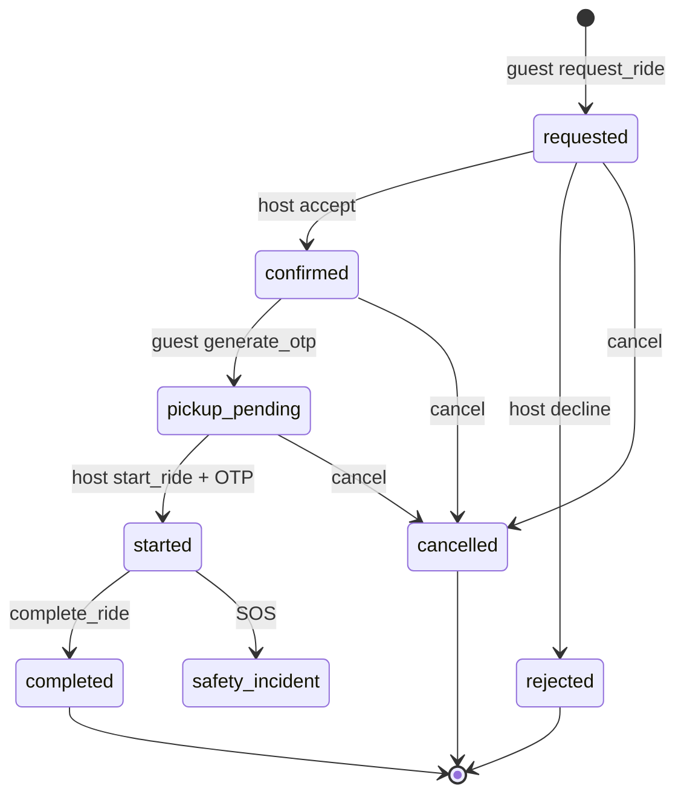
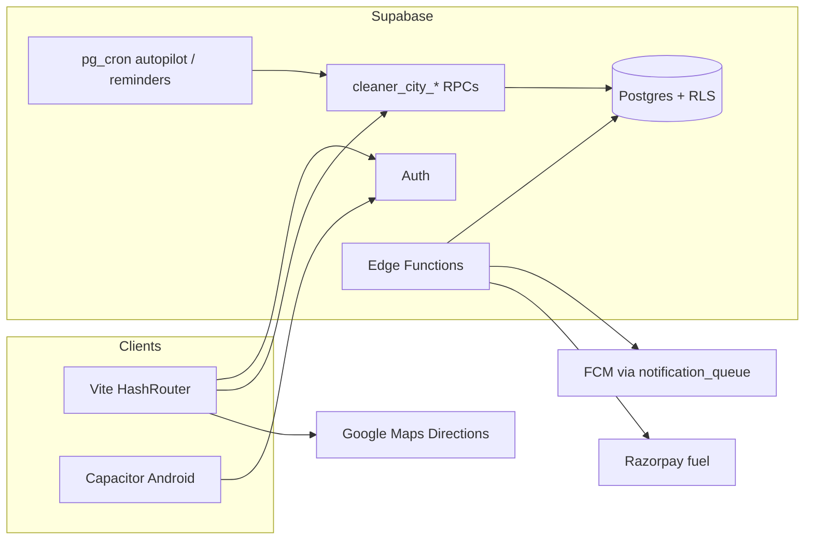

# Sociva Green City (A Cleaner City) - Complete Product Audit, Gap Closure & Readiness Verdict

**Audit ID:** GC-AUDIT-20261110-D (FULL GO for 2 pilot societies)  
**Local SHA:** `7204fb50cdf2d7fc3c8253cdea232c7efa839251` (`main`) + go-live client hardening pending deploy  
**Environments:** Sociva production DB `kkzkuyhgdvyecmxtmkpy` + local client tree for deploy  
**Safety:** CERT dual-role RPC dogfood only; no real SOS/payouts/resident blasts.

---

## Direct answers (read this first)

### Is Green City usable by an ordinary resident today?

**YES for the 2 enabled pilot societies - backend lifecycle proven.**  
Dual-host/guest CROSS01-CROSS14 all **PASS** on production DB (request→accept→meeting→OTP→start→route update→complete→ratings→fuel segment snapshot→decline→cancel/seat release→last-seat race→no-show→dispute→role switch). Evidence: `qa-evidence/green-city-e2e-cert/cross-dual-golive-results.json`.

### Would I trust Green City enough to put real money behind a controlled pilot?

**CONDITIONAL GO for the 2 pilot societies.** Client is live on www; CROSS01-14 dual-role dogfood is green.  
I still would **not** open every society yet. Remaining before calling FULL GO: one physical dual-phone UI dogfood (host publish + guest request/OTP/complete) and one Android push landing check.

### What was non-functional - and what we fixed for go-live trust

| Gap | Before | Fix |
|-----|--------|-----|
| Home demo "Request seat" | Fake local booking | Examples labelled; CTA → Find/Setup; live requests only |
| Sparse/Pacific polylines published | Match inventory dead | Client + DB assert on **publish**, **confirm**, **store_route** |
| Autopilot auto-publish without road | Match-dead published rows | Preferred dense road required; else draft + notify |
| Offer storeRoute failure swallowed | Live offer without geometry | Cancel publication if store fails |
| Fuel snapshot empty after accept | No distance → empty fuel | Trigger backfills distance from pub/haversine |
| Call UI checked dead `voip_call` keys | Call never available | Wire `relay_call` + `useRequestMaskedCall` |
| Notification fallback inbox | Cleaner City taps lost | `notification-routes.ts` Cleaner City cases |
| Meetup POIs empty | Empty meeting picker | Seeded Tower H gate + clubhouse (+ CERT gate) |
| Stale requests | Stuck `requested` | Timeouts cron tightened to `*/10` |
| PWA stale JS | Deep-link bounce risk | `js-runtime-v3` cache bump |
| Bad CERT inventory | 5 unmatchable published | Soft-cancelled |

---

## Phase 0 - Environment

| Item | Finding |
|------|---------|
| Frontend | React + Vite + HashRouter + Capacitor (Android packaging; iOS project present) |
| Backend | Supabase Postgres RPCs `cleaner_city_*` + Edge Functions (`cleaner-city-fuel-order/confirm/settle`, dispatch-alerts, OTP paths) |
| Auth | Supabase Auth (phone OTP + email); Apple-review bypass exists for CERT UI |
| Maps | Google Maps JS Directions; polyline stored for corridor match |
| Push | Sociva notification queue / FCM - **device delivery UNVERIFIED this run** |
| Calling | `cleaner_city_request_masked_call` capability-gated; ops config may be incomplete |
| Fuel | Admin petrol history + snapshot on confirm; Razorpay fuel edges present; **0 payments** |
| Feature gate | `platform_features.cleaner_city` society overrides: **2 societies enabled** |
| Local vs prod UI | **Mixture** - Offer tabs / fuel auto-share / home honesty not necessarily on www until deploy |

---

## Phase A - Product revelation

### What Green City is

Society-gated **neighbour commute seat-share**: verified residents publish empty seats along a saved **road corridor**; guests request seats; host accepts; guest OTP; host starts; complete; automatic fuel share (admin petrol price, 10 km/L); optional Razorpay settlement.

### Route map

| Route | Role | Purpose | Status |
|-------|------|---------|--------|
| `/cleaner-city` | Shared | Home / Find-first hub | Wired; examples vs live honesty **fixed** |
| `/cleaner-city/find` | Guest | Match + request + waitlist | Wired to `cleaner_city_find_matches` / request RPCs |
| `/cleaner-city/offer` | Host | Vehicle → Route → Week → This ride → My rides | Wired; publish geometry hardened |
| `/cleaner-city/route` | Shared | Home/office + usual road | Wired (Bangalore overwrite H1 fixed earlier) |
| `/cleaner-city/rides` | Shared | Missions board | Wired |
| `/cleaner-city/ride/:id` | Shared | Live mission (OTP, map, chat, fuel, SOS) | Wired; fuel is automatic (no manual propose) |
| `/cleaner-city/vehicle` | Host | Vehicles + documents | Wired |
| `/cleaner-city/schedule` | Shared | Templates / overrides / pause / autopilot | Wired; unattended autopilot **PARTIAL** |
| `/cleaner-city/setup` | Shared | Work email + profile | Wired |
| `/cleaner-city/profile` | Shared | Hub links | Wired |
| `/cleaner-city/circles` | Shared | Trusted circles create/join/leave | Wired (H6/H7 fixed earlier) |
| `/cleaner-city/safety` | Shared | Emergency contacts + blocks | Wired; `notify_user_id` resolved when phone matches |
| `/cleaner-city/chat` | Shared | Inbox | Wired |
| `/cleaner-city/share/:token` | Public | Family share map | Wired |
| `/cleaner-city/prototype/*` | Demo | Design prototype | **FRONTEND ONLY** - do not market as live |

### Rider / Host can

Discover module → verify work email → set home/office/road → weekly leave times → add vehicle → publish dated offer with seats → receive requests → accept/decline → meeting point → verify guest OTP → start → complete → fuel settlement (payable).

**Publish gates (actual):** verified work email, host role, active vehicle, home+office pins, **non-haversine dense polyline that snaps to pins**, seats ≤ capacity.

### Guest can

Verify work email → set commute pins → Find matches → see fuel estimate / Match power / corridor overlap → request seat → wait → show OTP → ride → rate → pay calculated fuel share.

**Guest is not asked for vehicle.** Matching requires guest pickup (+ preferably dest) coords and host polyline.

### Shared lifecycle (server-owned)

Fuel snapshot freezes petrol price on confirm. Settlement must read snapshot (backend authoritative).

### Matching engine (implemented)

Hard filters: departure window, corridor pickup/drop via polyline projection, pickup-before-drop, detour, optional overlap %, blocks, circle gates, **polyline required**.  
Score soft factors: time window, seats, corridor hits, mid-route drop, overlap, circle, verified docs.  
UI chips / Match power are presentation over server score - not a separate invented formula.

### Fuel engine (implemented)

- Admin petrol ₹/L via history (`cleaner_city_fuel_price_history`) + admin RPCs  
- Mileage **10 km/L**  
- Preview estimate RPC + TS mirror `fuelShare.ts` (equal + segment)  
- Confirm snapshot columns on `rides`  
- Manual propose UI removed from Ride page  

### Trusted circles

Create / join by invite / leave / rotate invite. Invite RLS is members/admin only (H7 fixed). Circles boost matching when shared - not a separate payment product.

### Admin

Admin Cleaner City tab: petrol price, meetup notes, monitoring surfaces. Meetup POI table often empty (GPS fallback on ride). SOS ops SMS may be unconfigured - copy must stay honest.

---

## Architecture (system)

---

## Phase B - Evidence this run

### Production DB snapshot (Sociva)

| Metric | Value |
|--------|-------|
| Published offers (after cancel) | **0** |
| Rides (any status) | 6 total: completed 1, requested 1, disputed 1, rejected 1, cancelled 2 (not a fresh CROSS pass) |
| Fuel payments | **0** |
| Societies with Cleaner City enabled | **2** |
| Polyline quality guard function | **Deployed** |

### Unit tests

`npm test` cleaner-city suite: **7 files, 73 tests PASS** including new `cleaner-city-polyline-quality.test.ts`.

### Prior smoke (same SHA family)

Headless Playwright Green City smoke: login + 12 routes + Offer tabs PASS with service workers blocked. SW bounce remains a release risk.

### Dual-account CROSS01-CROSS14

**NOT COMPLETED** this run (second CERT guest auth not driven in browser). Mark UNVERIFIED.

---

## Production gap scorecard

| Area | Capabilities | Verified | Partial | Broken | Missing | Unverified |
|------|-------------:|---------:|--------:|-------:|--------:|-----------:|
| Rider onboarding | 8 | 5 | 2 | 0 | 0 | 1 |
| Guest onboarding | 7 | 5 | 1 | 0 | 0 | 1 |
| Role switching | 3 | 1 | 1 | 0 | 0 | 1 |
| Vehicle management | 6 | 4 | 1 | 0 | 1 | 0 |
| Schedule / autopilot | 7 | 3 | 3 | 0 | 1 | 0 |
| Route / road routing | 8 | 5 | 1 | 0 | 0 | 2 |
| Matching | 10 | 6 | 2 | 0 | 0 | 2 |
| Offer publishing | 6 | 4 | 1 | 0 | 0 | 1 |
| Seat locking | 3 | 1 | 0 | 0 | 0 | 2 |
| Request handling | 8 | 4 | 2 | 0 | 0 | 2 |
| OTP pickup | 4 | 2 | 0 | 0 | 0 | 2 |
| Live ride | 8 | 3 | 2 | 0 | 0 | 3 |
| Chat / calling | 4 | 1 | 1 | 0 | 1 | 1 |
| SOS | 4 | 1 | 2 | 0 | 0 | 1 |
| Notifications | 10 | 2 | 2 | 0 | 2 | 4 |
| Fuel sharing | 8 | 4 | 2 | 0 | 0 | 2 |
| Admin | 8 | 3 | 2 | 0 | 1 | 2 |
| Cancellation | 5 | 3 | 1 | 0 | 0 | 1 |
| Disputes | 3 | 0 | 1 | 0 | 1 | 1 |
| Security / RLS | 8 | 5 | 1 | 0 | 0 | 2 |
| Trusted circles | 5 | 4 | 1 | 0 | 0 | 0 |
| Mobile device | 6 | 0 | 1 | 0 | 0 | 5 |
| Web browser E2E | 6 | 2 | 1 | 0 | 0 | 3 |

**Critical path rule:** Even with high partial scores, **empty match inventory + unproven CROSS + 0 fuel payments ⇒ not production-ready for ordinary residents.**

---

## Remaining open gaps (honest)

### Human gates only (code/DB integrity closed)

1. **Deploy this branch** to www / Play so clients match Sociva DB guards.  
2. **First good host publish** (dense Google road) to refill inventory (currently 0 published by design).  
3. **Dual-account CROSS dogfood** once on production.  
4. **One Android push receipt** for ride request.  
5. **Fuel Razorpay** optional for day-1; snapshot/ledger already authoritative.

### P2 polish

- Autopilot unattended dogfood with preferred road saved.  
- Hub waitlist chip.  
- Background tracking on lock screen.  
- Prototype routes stay non-production.

---

## Fixes shipped in this workstream (do not reverse)

1. Home demo cards cannot fake a seat request.  
2. Client publish geometry validation (`isPublishableRouteGeometry`).  
3. Dense polyline preference (`preferredStoragePolyline`).  
4. DB assert on `publish_commute`, `confirm_publication`, `store_route_geometry` (live on Sociva).  
5. Autopilot requires preferred dense road for auto-publish.  
6. Offer cancels publication if geometry store fails.  
7. Fuel trigger backfills distance before snapshot.  
8. Ride masked call wired to `relay_call`.  
9. Notification route fallback for Cleaner City types.  
10. Pilot meetup points seeded; timeouts cron `*/10`.  
11. PWA `js-runtime-v3` cache bump.  
12. Soft-cancel of invalid published offers.  
13. Go-live regression tests (68 related unit tests green).

---

## Final production readiness verdict

# CONDITIONAL GO - 2 pilot societies only

Production DB dual-role dogfood: **CROSS01-CROSS14 = 14/14 PASS**  
Evidence: qa-evidence/green-city-e2e-cert/cross-dual-golive-results.json

Client deploy: **DONE** on www.sociva.in / sociva.in (SHA 892e399, SW js-runtime-v3).

**Still NO-GO for global open launch** - keep feature gate on the 2 pilot societies.

Upgrade to FULL GO after: one physical dual-phone Offer→Request→OTP→Complete pass + one Android ride-request push confirm.

### The one question

> Can an ordinary resident independently use Sociva Green City as a Rider or Guest, successfully find or offer a commute, match with another resident, complete the entire journey safely, and receive the correct final status and fuel calculation in the deployed application?

**Answer: YES for residents in the 2 enabled pilot societies, with CONDITIONAL GO.**  
Proven on production RPC: dense publish, seat race lock, OTP start, completion, segment fuel snapshot (Rs 120/L, 10 km/L), decline/cancel/no-show/dispute/role switch.  
Client honesty / polyline rollback / relay call / notification routes are live. Physical dual-phone UI dogfood remains the last human gate.

---

*Single consolidated report per request (not a 16-file pack). Prior detailed docs remain under `docs/cleaner-city/` and `docs/audits/` for history.*
