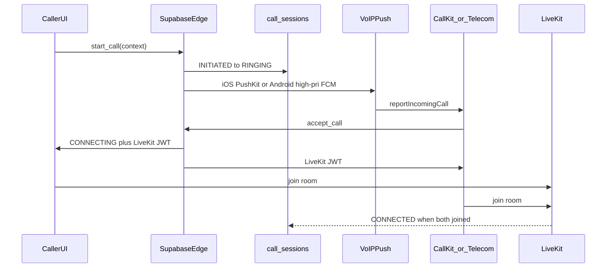

# Sociva Universal In-App VoIP Calling

**Overview:** Introduce one Sociva-wide in-app VoIP stack (LiveKit Cloud + PushKit/CallKit + Android Telecom/FCM) reusing existing device tokens, notification workers, and module authorization gates, then wire Call into Green City and Orders first, followed by HelpHub, bookings, delivery, and seller surfaces.

## Implementation todos

- [x] Phase 0: Add `call_sessions` / `call_events` + `device_tokens.voip_token` migration, RLS, ring timeout sweeper
- [x] Phase 1: Implement voip-call edge (start/respond/end/dispatch) + LiveKit JWT mint + authZ RPCs (flagged off until secrets)
- [ ] Phase 2: Build Cap VoIP plugin; iOS PushKit+CallKit; Android FCM+Telecom/CallStyle FG service; Codemagic plist/entitlements patches (stubs registered; full CallKit/Telecom pending Apple VoIP cert)
- [x] Phase 3: Ship shared CallButton (outgoing sheet / active call bar / deep links still thin)
- [x] Phase 4: Green City CallButton wired; Orders/HelpHub/bookings/delivery/seller still pending
- [ ] Phase 5: Admin call metrics dashboard from call_sessions/events
- [ ] Phase 6: Physical device matrix + regression on existing push/Retell/Codemagic builds

## Architecture assessment (audit result)

### What already exists (reuse)

| Area | Reality | Reuse |
|---|---|---|
| Stack | React/TS Capacitor 8 app; Android committed under [`android/`](../../android/); iOS project regenerated in Codemagic and patched from [`native/ios/`](../../native/ios/) + [`codemagic.yaml`](../../codemagic.yaml) | Keep Cap 8; put VoIP native sources in `native/ios/` and `android/...` with CI copy/patch like Live Activities |
| Push | [`usePushNotifications.ts`](../../src/hooks/usePushNotifications.ts), `device_tokens` + `claim_device_token`, FCM + APNs, [`process-notification-queue`](../../supabase/functions/process-notification-queue/index.ts), Android [`OrderAlertMessagingService.java`](../../android/app/src/main/java/app/sociva/community/OrderAlertMessagingService.java) for killed-app seller alerts | Reuse token identity and FCM plumbing; **do not** send iOS VoIP via ordinary APNs alert path |
| Audio perms | Android `RECORD_AUDIO` / `MODIFY_AUDIO_SETTINGS` already declared; iOS mic string already set for Retell Talk-to-Sociva | Extend copy; add VoIP background modes carefully |
| FG services | [`LiveDeliveryService`](../../android/app/src/main/java/app/sociva/community/LiveDeliveryService.kt), [`CommuteTrackingService`](../../android/app/src/main/java/app/sociva/community/CommuteTrackingService.kt) | Pattern for active-call foreground service (`microphone` / `phoneCall` type) |
| AuthZ patterns | Cleaner City [`cleaner_city_request_masked_call`](../../supabase/migrations/20261102240000_cleaner_city_five_feature_gaps.sql) (confirmed ride only); Contact Seller phone reveal; HelpHub contact + [`CallFeedbackSheet`](../../src/components/helphub/CallFeedbackSheet.tsx); order `tel:` links in [`OrderDetailPage.tsx`](../../src/pages/OrderDetailPage.tsx) | Reuse relationship checks; replace `tel:` / Twilio queue with in-app call invitations |
| Chat | Ride chat, marketplace chat | Orthogonal - keep; Call is separate transport |
| AI voice | Retell [`useSocivaVoiceCall.ts`](../../src/hooks/useSocivaVoiceCall.ts) / Talk to Sociva | **Keep isolated** - not peer VoIP |

### What does **not** exist (introduce)

- No PushKit, CallKit, ConnectionService/Core-Telecom, or VoIP push tokens
- No peer WebRTC room/session tables or call lifecycle RPCs (`call_sessions` / voip absent from migrations)
- No LiveKit/Agora SDK integration for user-to-user audio
- Cleaner City "Relay call" only queues Twilio PSTN via [`cleaner_city_request_masked_call`](../../supabase/migrations/20261102240000_cleaner_city_five_feature_gaps.sql) + [`cleaner-city-dispatch-alerts`](../../supabase/functions/cleaner-city-dispatch-alerts/index.ts) and is **not configured** (UI toast: calling not configured)
- Marketplace/orders/HelpHub use **device dialer `tel:`** after phone reveal RPCs (exposes numbers)
- Delivery partner sees buyer phone as plain text in [`DeliveryActionCard.tsx`](../../src/components/delivery/DeliveryActionCard.tsx) with **no `tel:`** today
- iOS `UIBackgroundModes` today: `remote-notification`, `fetch` only - **no `voip` / `audio`** (Codemagic intentionally strips `location`)
- `claim_device_token` has **no VoIP/PushKit parameter**; alert tokens only (`token` + `apns_token`)

### Audit confirmation

Explore audits confirm Cap 8 + mature alert push, zero native VoIP, and module-by-module `tel:` / relay surfaces. Any "prefer PSTN wrapper unless product requires VoIP" note is **overridden** by the product brief: peer in-app VoIP is mandatory. Reuse gated authZ/reveal RPCs; replace primary call transport with LiveKit + native ring.

Extra reuse anchors:

- Separate APNs push-type precedent: `live_activity_tokens` + [`update-live-activity-apns`](../../supabase/functions/update-live-activity-apns/index.ts) (`apns-push-type: liveactivity`) - same pattern for VoIP topic/token
- Android wake template: [`OrderAlertMessagingService.java`](../../android/app/src/main/java/app/sociva/community/OrderAlertMessagingService.java) + [`OrderAlertChannels.java`](../../android/app/src/main/java/app/sociva/community/OrderAlertChannels.java) - branch `type=voip_incoming` without breaking seller alerts
- iOS ship path: repo `ios/` is incomplete locally; **`native/ios/` + `codemagic.yaml`** is SoT for native Swift
- Module CallButton targets: [`ContactSellerModal.tsx`](../../src/components/product/ContactSellerModal.tsx) / `log_seller_contact_interaction`; HelpHub `helphub_get_contact_phone` + [`CallFeedbackSheet.tsx`](../../src/components/helphub/CallFeedbackSheet.tsx); Cleaner City ride page relay; order/delivery tracker phones; seller refund `tel:` in [`SellerRefundActions.tsx`](../../src/components/refund/SellerRefundActions.tsx)

## Locked decisions

- **RTC provider: LiveKit Cloud** (JWT from edge functions, native iOS/Android SDKs, room-per-call-id, no client secrets).
- **Rollout: phased** - core platform + **Green City + Orders** first (meets acceptance), then HelpHub, bookings, delivery, seller dashboard.
- **Primary UX: in-app VoIP**. Keep `tel:` only as explicit fallback when recipient has no VoIP-capable token (show clear copy; never claim native ring succeeded).
- **Do not** repurpose Retell or ordinary `notification_queue` alert pushes for iOS CallKit wakes.
- **No call recording**.

## Platform components (naming aligned to Sociva)

| Logical | Implementation home |
|---|---|
| CallManager | `src/lib/calling/CallManager.ts` + Cap plugin bridge |
| CallSignallingService | edge `voip-call-lifecycle` + Realtime on `call_sessions` |
| CallNotificationService | edge `voip-dispatch` (PushKit APNs topic + FCM data) |
| VoIPTokenManager | Cap plugin + `device_tokens.voip_token` / `voip_token_updated_at` |
| CallSessionManager | Postgres RPCs `voip_start_call`, `voip_respond`, `voip_end`, `voip_heartbeat` |
| CallPermissionManager | Cap plugin (mic + Android full-screen intent / phone account) |
| CallHistoryService | `call_sessions` select RLS + `src/hooks/queries/useVoipCalls.ts` |
| CallContextResolver | `src/lib/calling/resolveCallContext.ts` (order/ride/booking/helphub/delivery) |

## Phase 0 - Schema and secrets

Migration (new):

- `call_sessions`: id, caller_id, callee_id, context_type, context_id, society_id, status, livekit_room, started_at, ringing_at, connected_at, ended_at, end_reason, duration_seconds, idempotency_key, metadata jsonb
- `call_events` (append-only audit): call_id, event, actor_id, payload, created_at
- `device_tokens`: add `voip_token`, `voip_platform`, `voip_token_updated_at` (iOS PushKit token separate from FCM/APNs alert token)
- Status enum matching product states: `initiated|ringing|accepted|connecting|connected|rejected|missed|busy|failed|cancelled|ended`
- RLS: participants + admin only; never expose phone numbers in call APIs
- RPCs enforce context authorization (see Phase 4)
- 30s ring timeout via `pg_cron` or edge sweeper
- Rate limits + block checks (`commute_blocks` + existing user blocks)

Secrets (Supabase + Codemagic, never client):

- `LIVEKIT_URL`, `LIVEKIT_API_KEY`, `LIVEKIT_API_SECRET`
- Existing APNs key reuse for **VoIP push topic** (`com.sociva.app.voip` style) - separate cert/topic as Apple requires
- FCM already present

## Phase 1 - Backend lifecycle

Edge functions (new, mirror existing invoke patterns):

1. `voip-start-call` - auth caller, resolve context, create session idempotently, dispatch VoIP push, return session + caller LiveKit token only after accept path or provisional room create
2. `voip-respond-call` - accept/reject; mint short-lived LiveKit JWTs for both parties; set CONNECTING
3. `voip-end-call` - cancel/miss/end with reason; delete/expire room
4. `voip-dispatch` - platform fanout; mark push delivery evidence on session
5. `voip-livekit-webhook` (optional) - room empty / participant left -> ENDED

Rules:

- Never mark CONNECTED until both sides report media up (client heartbeat or LiveKit webhook)
- Busy if callee already in `ringing|accepted|connecting|connected`
- Idempotency on `(caller_id, context_type, context_id, idempotency_key)`

## Phase 2 - Native + Capacitor plugin

### iOS (`native/ios/SocivaVoipPlugin.swift` + CallKit/PushKit helpers)

- PushKit registry; register VoIP token to JS -> `claim`/upsert `voip_token`
- On VoIP push: **immediately** `CXProvider.reportNewIncomingCall` (Apple requirement)
- CallKit answer/end/mute -> plugin events to JS / native LiveKit join
- Add `voip` + `audio` to `UIBackgroundModes` in Codemagic Info.plist patch (alongside existing remote-notification)
- Update mic usage string for peer calling (not only Talk to Sociva)
- Copy plugin into `ios/App` like Live Activity files

### Android

- Extend [`OrderAlertMessagingService`](../../android/app/src/main/java/app/sociva/community/OrderAlertMessagingService.java) **or** sibling `VoipMessagingService` branch: if `data.type=voip_incoming`, start Telecom/self-managed ConnectionService + CallStyle + full-screen intent (do not break seller order alert path)
- Permissions: `MANAGE_OWN_CALLS`, `USE_FULL_SCREEN_INTENT`, `FOREGROUND_SERVICE_MICROPHONE` / phoneCall, Bluetooth connect
- Play declaration notes for full-screen intent (incoming calls)
- Active call FG service while CONNECTED

### Capacitor

- New local plugin `@sociva/voip` (TypeScript definitions + register in bridge VC / MainActivity)
- JS API: `registerVoipToken`, `startOutgoing`, `endCall`, `setMuted`, `setSpeaker`, events `incoming`, `accepted`, `ended`, `audioRoute`

### LiveKit

- Native SDK join on answer (preferred for background audio) with JS active-call chrome observing session state via Realtime

## Phase 3 - Shared calling UI

Single surface used by all modules:

- [`src/components/calling/OutgoingCallSheet.tsx`](../../src/components/calling/OutgoingCallSheet.tsx)
- [`src/components/calling/ActiveCallBar.tsx`](../../src/components/calling/ActiveCallBar.tsx)
- Incoming: **native only** (CallKit / Telecom); optional in-app mirror when foreground
- [`src/components/calling/CallButton.tsx`](../../src/components/calling/CallButton.tsx) - takes `contextType` + `contextId` only
- Missed-call entry in existing notification / chat inbox deep link `sociva://call/:id`

## Phase 4 - Module authorization + wiring

| Module | Authorize when | Wire CallButton at |
|---|---|---|
| E Green City | Ride `confirmed|pickup_pending|started`; host/guest only; respect blocks | Replace Relay call on [`CleanerCityRidePage.tsx`](../../src/pages/cleaner-city/CleanerCityRidePage.tsx); retire Twilio queue for peer audio |
| B/A Orders | Parties on eligible order statuses (placed through in-delivery / active enquiry) | [`OrderDetailPage.tsx`](../../src/pages/OrderDetailPage.tsx), tracking overlays - replace primary `tel:` with in-app Call |
| G Seller | Same order eligibility, seller view | Seller order detail / refund contact |
| D HelpHub | Existing contact permission / listing rules | [`HelpHubListingCard.tsx`](../../src/components/helphub/HelpHubListingCard.tsx) after contact grant |
| C Bookings | Confirmed booking participant | Booking detail |
| F Delivery | Active assignment participant | [`LiveDeliveryTracker.tsx`](../../src/components/delivery/LiveDeliveryTracker.tsx), arrival overlay |

`CallContextResolver` centralizes these checks client-side for UX; **server RPCs re-validate**.

## Phase 5 - Admin monitoring

- Admin page metrics from `call_sessions` / `call_events`: totals, success, missed, failed, avg ring/connect/duration, APNs/FCM/LiveKit failure counters, module breakdown
- No transcript/audio storage

## Phase 6 - Verification and regression

Physical device matrix (evidence required for PASS):

- iOS↔iOS, Android↔Android, cross; FG/BG/locked/terminated; force-stop documented as OS-limited
- Mic/notification denied paths; reject/miss/cancel; busy; Wi-Fi↔cellular; Green City + order contexts

Regression:

- Seller order alerts still posted by `OrderAlertMessagingService`
- Ordinary `notification_queue` / Cleaner City pushes unchanged
- Retell Talk-to-Sociva unchanged
- Codemagic ios-release / android-release still green

Automated: Vitest for resolver + RPC contract tests; optional Detox/Playwright smoke for CallButton enablement only (not ring delivery).

## Rollback

- Feature flag `voip_calling_enabled` (society + global)
- Client falls back to existing `tel:` / disabled Call with copy
- Drop VoIP dispatch without removing order FCM path
- LiveKit keys revocable independently

## Implementation order (after plan approval)

1. Migration + RPCs + edge stubs + LiveKit token mint
2. Cap plugin skeleton + token registration
3. iOS PushKit/CallKit + Android Telecom/FCM incoming
4. Shared UI + Green City + Orders integration
5. Remaining modules
6. Admin metrics
7. Device lab report + Codemagic build with VoIP entitlements

## Credential blockers (must supply before Phase 1 can go live)

- LiveKit Cloud project URL + API key/secret in Supabase secrets
- Apple VoIP Services certificate / key for PushKit topic
- Play Console full-screen intent declaration text for incoming calls
